# Delegate 目标架构 V2：从用户输入到最终交付

日期：2026-09-28。依据：[最终优先级与交付计划](agent-priority-and-delivery-plan.md)、[整改技术方案 V2.1](agent-remediation-final-plan.md)、[代码与测试自检](reviews/delegate-architecture-selfcheck.md)。本文替代2026-09-24旧流程图中的流程顺序。

代码实施已开始；各节点的当前完成范围与验证证据见[实施验收记录](agent-implementation-progress.md)。

**这是待落地的目标流程，不是所有节点已实现或已通过验收。** 每图包含逻辑职责，不代表新增服务，也不代表每个方框调用一次模型。第14节区分当前基础、本轮改动和后续能力。

核心：一个 Pi 主 Agent；服务端维护可信身份、有效任务、权限、审批、预算和真实状态；知识、记忆、Skill正文按需加载；工具选择由主 Agent 完成；硬检查常驻，语义复核按需。近期不增加独立前置路由模型。

所有重试、补证、修订与恢复循环都受累计预算、取消状态及停止条件限制；循环箭头不表示无限重试。下文的“权限检查”包括拒绝分支，即使总览未重复画出。

## 1. 整体主流程

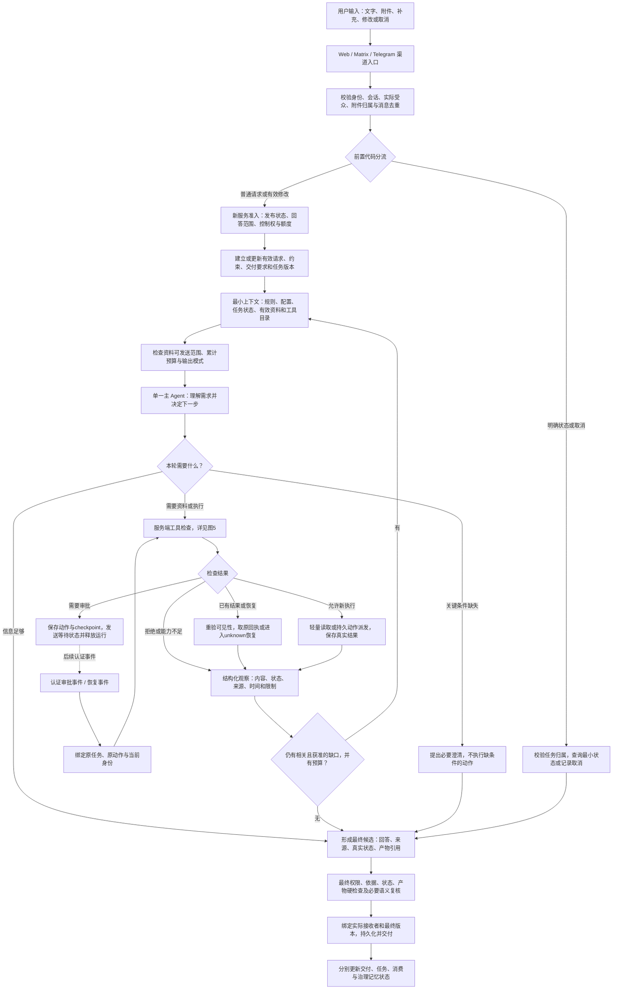

本图省略各入口拒绝分支，详见图2/5/10。图中主路径采用缓冲输出；可选真流式是图10的独立受控分支，首批不依赖它。审批/恢复不通过主模型重新发明已经批准的动作。

## 2. 用户输入、前置分流与任务修改

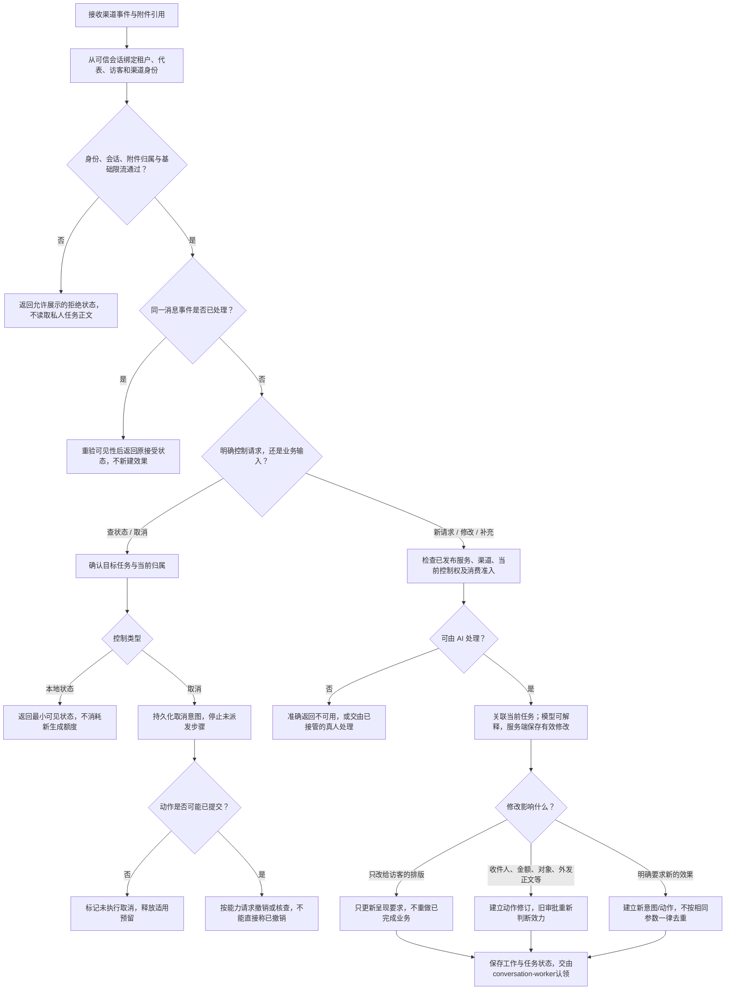

模糊取消或unknown之后的“再来一次”需要明确对象/意图，不机械猜测。仅修改访客看到的排版与修改实际发送的邮件正文不同：后者仍是动作参数变化。代表暂停或新额度不足不应挡住经授权的最小本地状态查询；外部查询/取消如有成本，使用有界恢复预算。

## 3. 每轮到底发送什么给模型

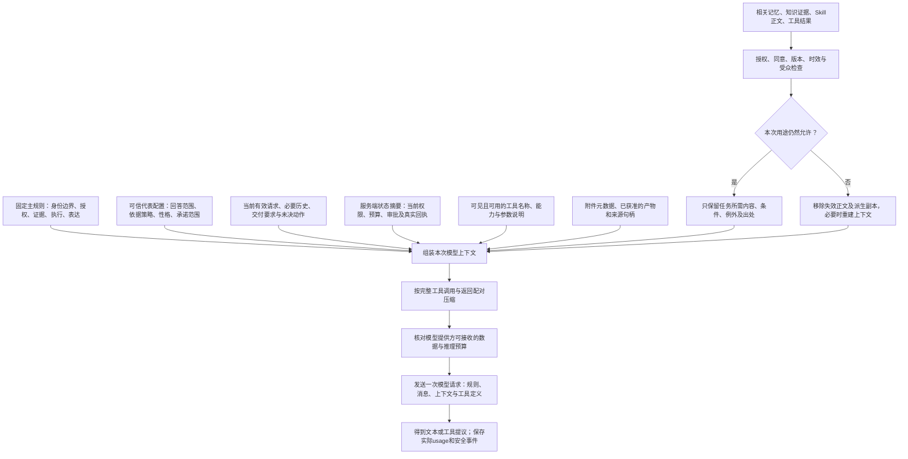

- 工具目录是能力说明，不是工具已经执行。近期保留简洁完整的获准目录，不增加一次专用路由调用。
- 不默认上传全部知识、全部记忆、全部Skill正文和所有历史；相关正文按需取用。附件元数据不证明已读取文件。
- 网页、附件、检索结果、记忆、外部工具描述和Skill内容不能扩大权限或覆盖平台规则。Skill提供方法，实际调用仍走图5。
- 平台/模型/云端密钥留在服务端适配层；模型只看到必要的能力与身份范围摘要。

## 4. 同一个主 Agent 如何选择知识与能力

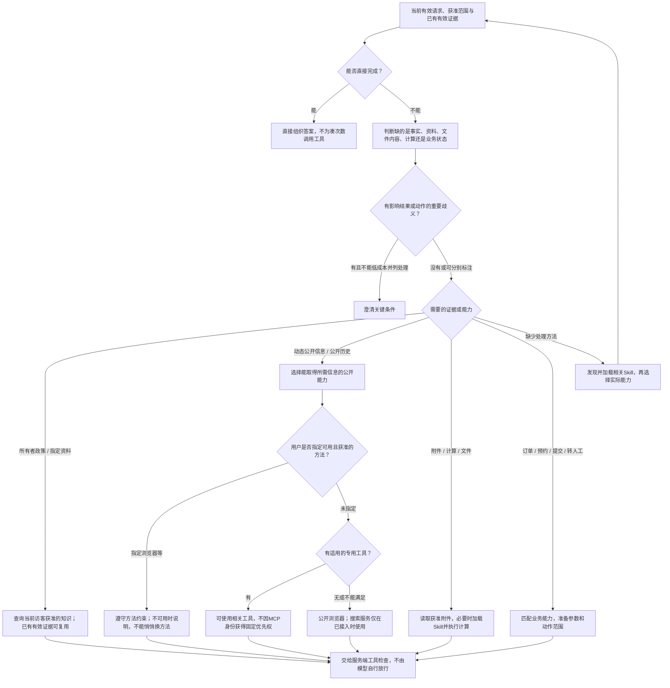

这张图表示主Agent的决策职责，不是一个前置分类模型，也不是股票/天气等行业关键词路由。多步骤任务在同一个循环中推进；每一步必须能解释它填补了什么缺口。稳定常识按代表范围可以直接回答；不能将普通公司的公开价格误归为所有者内部政策。

## 5. 所有工具出口的共同检查与轻重分路

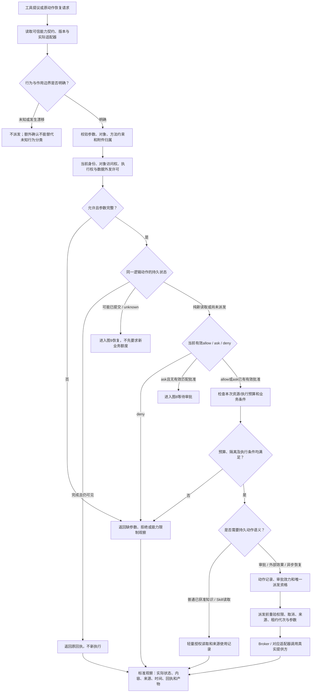

只读、已授权、需审批是三个独立属性。只读仍可能受限或被配置为ask；获准写入也可能为allow。知识读取不强制经过外部动作Outbox，但必须有同等有效的数据访问检查。工具可见不表示获准执行，schema一致也不证明远端真实行为只读。

## 6. 授权知识、记忆及撤回的完整路径

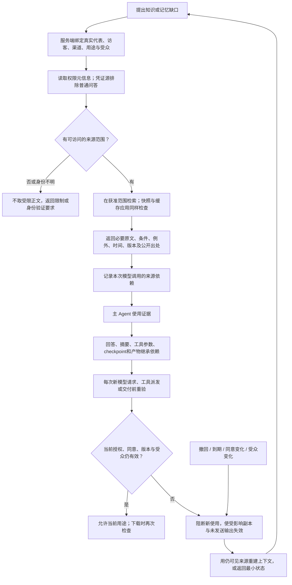

模型没有引用某来源，不代表其输出不含该来源；默认采用调用级保守继承。无命中、权限不足、检索故障和资料冲突要区分，不把无命中推断为事实不存在。不能收回已经合法发送的历史内容；保证是阻止后续使用与新披露，边界以实际派发阶段为准。

记忆只有在渠道支持、身份/同意/代表范围均允许时参与；匿名跨渠道不自动合并。源正文先过滤再读取，不能先全取后要求模型自觉保密。

## 7. All-in-One 浏览器、附件与文件交付

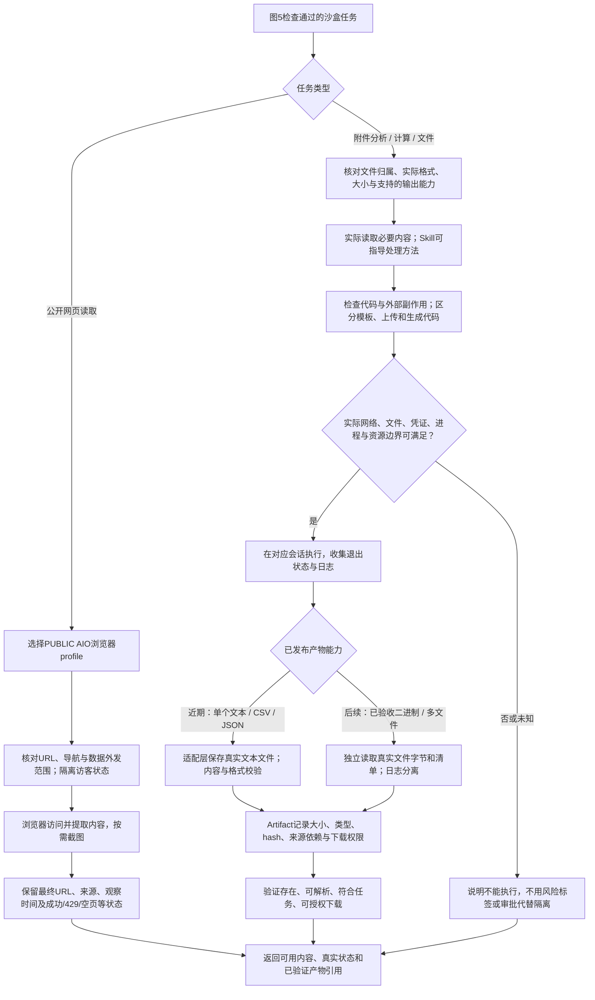

当前PUBLIC工具不能被宣称具有已验证的实例级禁网；有此要求的任务需独立验证其他profile。正常获准的公共浏览继续可用。通用浏览器如涉及登录、提交表单或其他效果，回到动作权限与审批路径；不能因为名称是“浏览器”就当作全部只读。

上传脚本不要求先原样执行。代码hash只证明内容一致；平台密钥不交给代码，认证浏览器和其他访客文件不能被任意代码共享。文本改名为XLSX/PDF不能交付成功；浏览器已有截图能力不代表代码工具支持任意图片生成。

## 8. 审批、参数变化与恢复时序

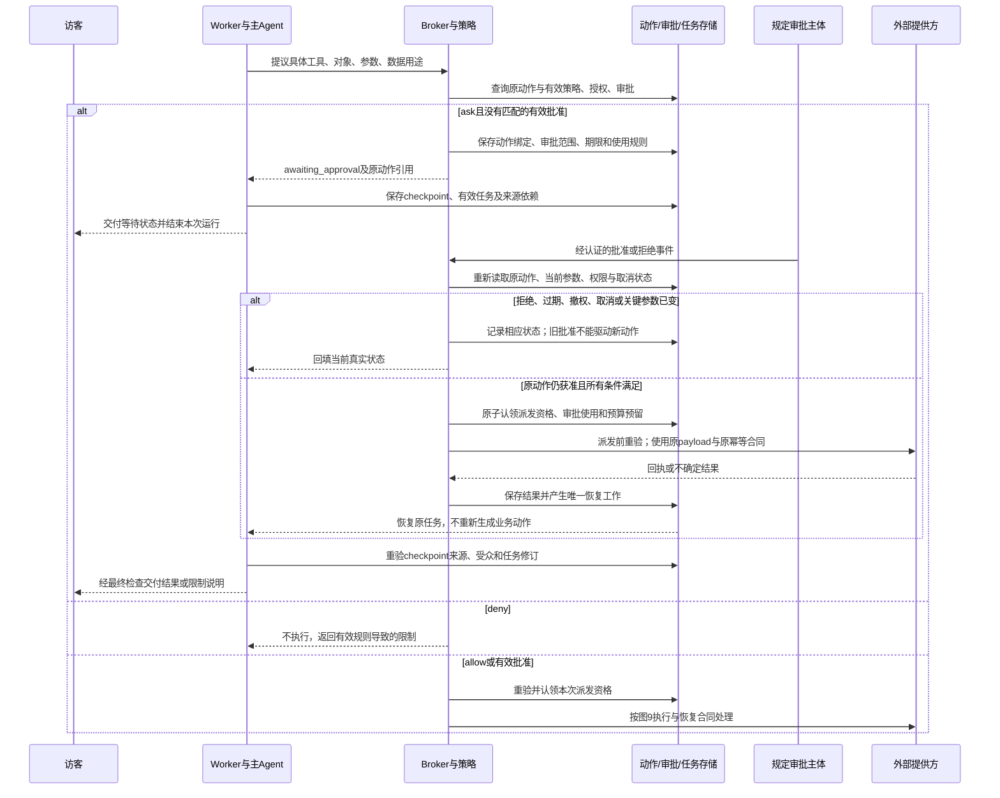

等待期间不保持数据库事务或模型连接。批准不能扩大原本没有的数据/对象权限。只修改给访客的答复格式通常不重新审批；更换收件人、金额、对象、实际外发正文或附件需要重新判定。晚回执归原动作，保留实际发生的结果，不能覆盖新任务。

## 9. 外部动作、超时、取消与幂等恢复

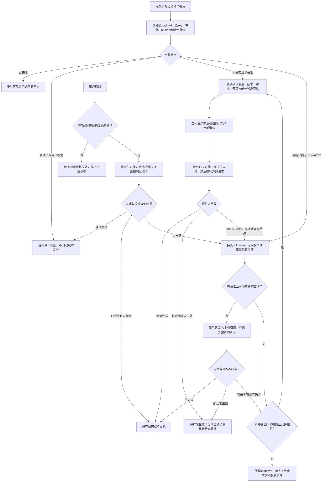

恢复必须保持原动作、原参数、原提供方key；新attempt不等于新业务效果。暂未查到不等于未执行；部分成功不能整批重放；不得换浏览器/脚本绕过unknown冻结。外部查询有界，额度不足时仍可展示最小本地状态。数据库事务和本地租约不保证任意外部服务恰好一次；越过界线后的取消只能依据真实结果表述。

## 10. 最终答案、硬检查、语义复核与输出模式

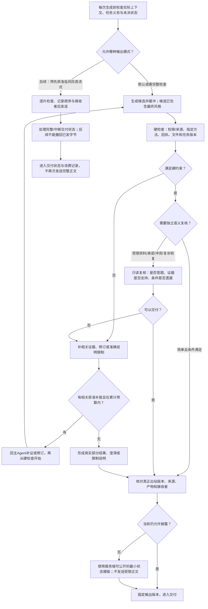

近期先验证简单问答少一次模型调用，真流式是单独后续项；简单路径也不跳过硬检查。真流式资格依赖受约束的实际上下文和能力，不能靠模型自称低风险；若发现需工具/受限资料等资格变化，停止新增正文流出，转入缓冲检查。服务端关键状态不能被reviewer的布尔值抹除；queued、accepted、unknown不冒充完成。语义复核无执行授权。核验之后不再新增风格模型，任何改写后都要检查最终内容。

来源规则统一：知识来源以产品允许公开的引用展示为主；动态网页注明必要来源、时间及状态；允许提及用户提供的名称，但不能伪造已验证来源。敏感正文不能先流出再补审。

## 11. 最终交付、渠道故障、消费与记忆

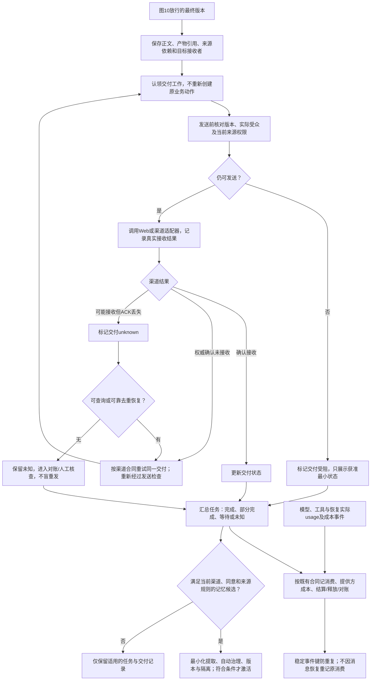

业务成功、消息交付成功、整个任务完成分别记录；不因ACK丢失重做业务。收费时点继续按现有合同，不在图中改成全部执行即收费或全部ACK后收费。记忆处理依据真实交付/使用资格，不自动将所有聊天或失败草稿转长期记忆。

审计贯穿入口、模型调用、工具检查、派发、回执和交付各阶段；**每次写通用日志前最小化**，并非等任务结束才脱敏。客户端显示任务阶段和真实进展，不显示隐藏推理、私人正文、原始工具参数或内部凭证。

## 12. 贯穿全链路的可信记录与模块归属

| 数据/职责 | 复用基础 | 新方案要求 |
| --- | --- | --- |
| 会话与任务 | GenerationRun、消息事件、worker工作租约 | 当前有效请求、呈现/动作修订、停止原因、累计预算；模型只提议不能自行改权 |
| 能力与策略 | compute-protocol、capability-policy、工具目录、Broker | 行为/权限/审批/恢复合同分开；目录、adapter和执行端一致 |
| 业务动作 | ToolExecution、审批、Outbox或等价持久记录 | 稳定动作与attempt；原payload/key；派发界线、取消、审批效力与代次 |
| 来源与上下文 | OpenViking、MemoryUseRun、Pi消息/checkpoint | 检索前授权、条件完整、派生依赖、撤回与完整交互压缩 |
| 产物 | Artifact存储与下载入口 | 当前格式真实校验；后续字节清单；每次下载当前来源与受众重验 |
| 交付 | conversation-worker、渠道adapter、deliveryOnly | 固定最终版本，发前检查，ACK未知单独恢复，不重做业务 |
| 额度与成本 | 现有双账本、billingSnapshot、唯一事件键 | 维持收费合同，逐事件对账，模型/工具成本与用户额度分别计量 |
| 观测 | Pi telemetry、agentTrace、Broker事件 | 入库前最小化；真实usage/延迟；不记录隐藏推理或原始私密参数 |

这不是八个新服务。优先复用现有结构；只有缺少的语义才补字段或模块。主要接线点仍是 `apps/reps` 输入入口、`apps/conversation-worker/src/processor-pi.ts`、`packages/model-runtime/src/pi/`、`apps/compute-broker/src/` 与 `packages/web-data/src/`。

## 13. 用原始问题走一遍

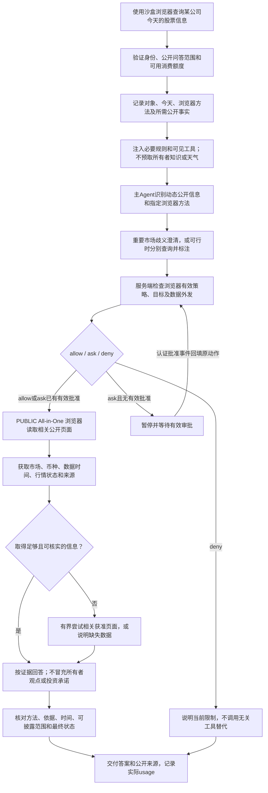

这条链路不需要新增“股票专用Agent”，也不需要为100个场景各写一个工具。天气能力只有在确实缺天气信息时才适用；通用浏览器可承担不同领域的公开网页读取，但并不保证所有网站可访问或所有数据实时。

## 14. 哪些已有，哪些本轮改，哪些以后再做

| 部分 | 已有基础或自检证据 | 本轮目标 | 后续/条件性扩展 |
| --- | --- | --- | --- |
| 前置入口 | 已有status/cancel分支和身份/准入机制 | 将本人旧任务管理放到新服务准入前；补任务修订语义 | 不新增独立语义路由模型 |
| 主Agent与工具 | 已有Pi循环、小规模可见目录、按需Skill/知识读取 | 统一规则、工具分类、有效策略与任务依据义务 | 大目录发现/裁剪、只读并行需收益证据 |
| 审批恢复 | 已有通知、payload hash、重验、部分CAS与晚回调保护 | 补端到端动作身份、原key、派发代次和跨运行unknown | 提供方不支持的保证不作承诺 |
| 资料治理 | 已有MemoryUseRun与出站检查，隔离PG子项通过 | 扩展到派生参数/checkpoint/文件/实际接收者 | 更广缓存先评估，不默认新建 |
| 沙盒 | 已接PUBLIC AIO与浏览器适配 | 风险标签不放权、profile真实约束、访客隔离验证 | SANDBOX/VPC按需要另测 |
| 文件 | Pi当前主要stdout转单文本，浏览器有独立截图能力 | 限定真实支持格式，校验内容和下载 | 二进制/多文件逐项验收后声明 |
| 输出 | v2已有草稿缓冲，受控简单文本为2次模型 | 先试符合条件的一次主模型，硬检查仍在 | 真流式单独验证，不作为首批前提 |
| 交付/账本 | 已有Outbox、交付恢复、账本幂等基础 | 补业务成功/ACK丢失联合故障和PG失败闭环 | 不重设计收费合同 |

首批M1覆盖直接体验改善与必要边界；M2/M3完成相关高风险能力闭环。P0未满足时只限制受影响路径，不把普通公开查询等待全部新功能完成作为默认策略。图中“后续”分支在验收并发布能力之前不向模型承诺可用。

## 15. 图的检查范围

本文件为架构与数据流设计。Mermaid语法校验不代表实现通过；真实执行、权限、取消竞态、来源撤回、文件字节、下载、渠道回执和账本仍按R01–R16、T01–T22及新旧质量对照验收。代码实现已经另行开展，完成范围以实施记录为准；没有进行部署。
