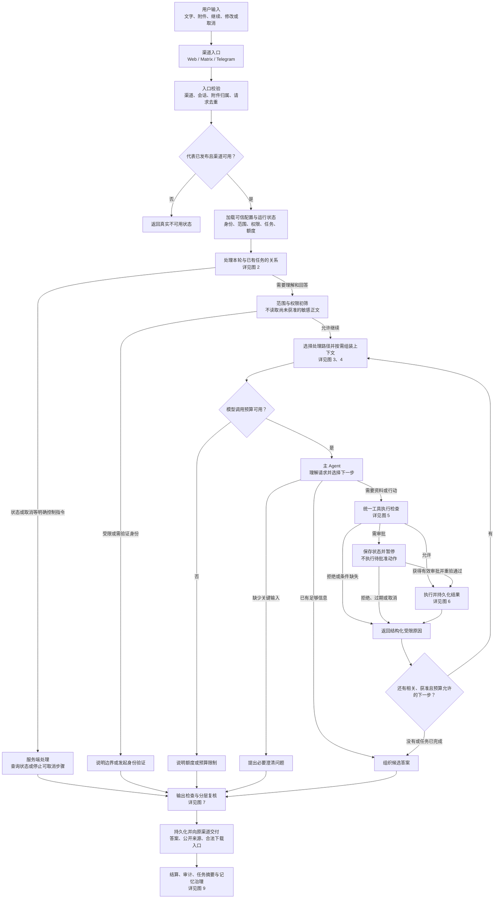
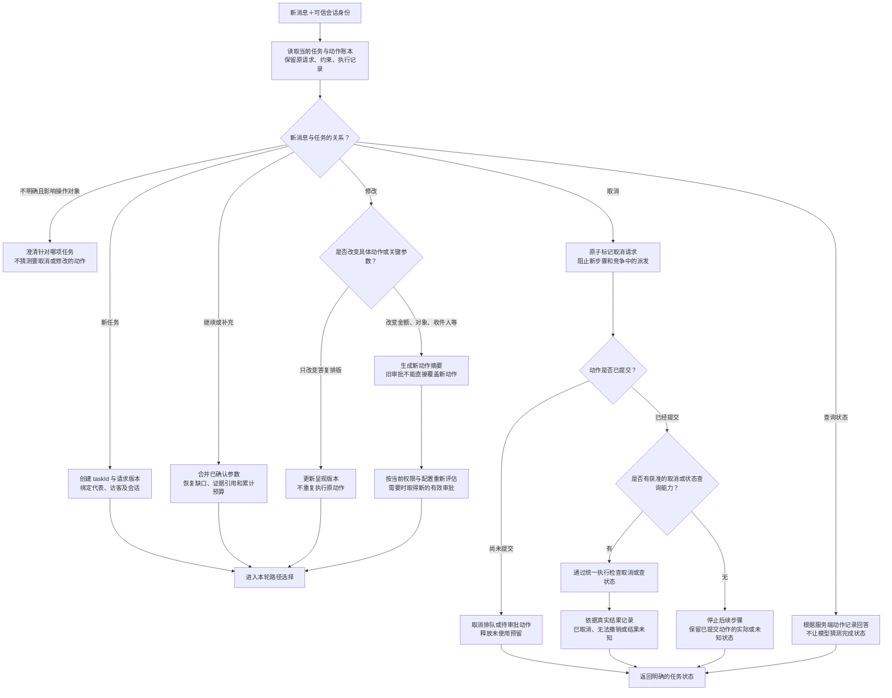
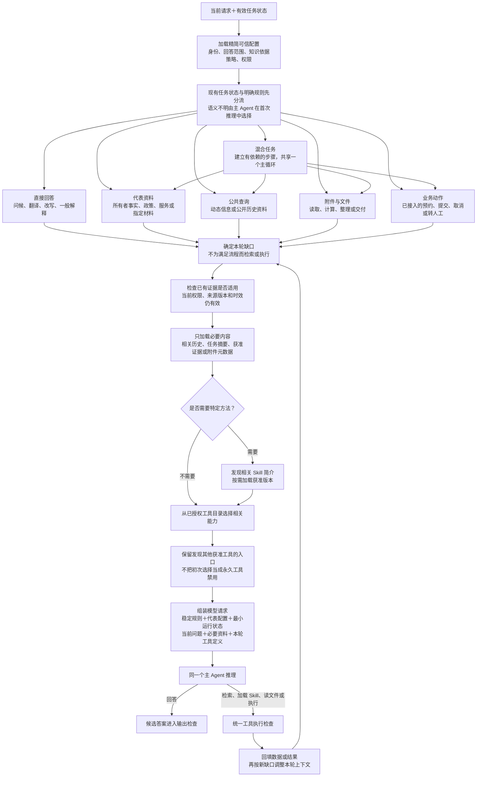
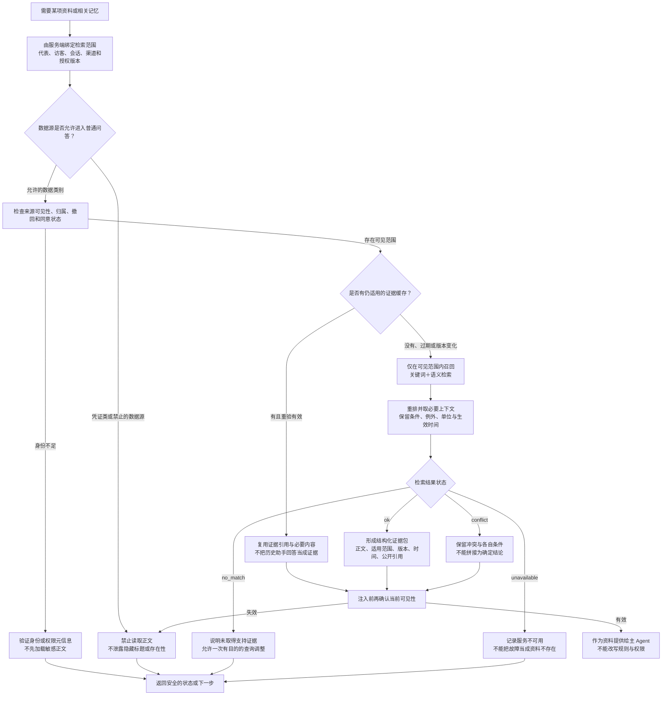
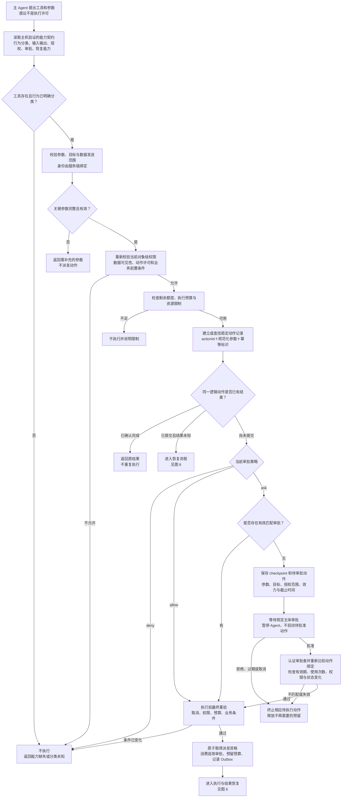
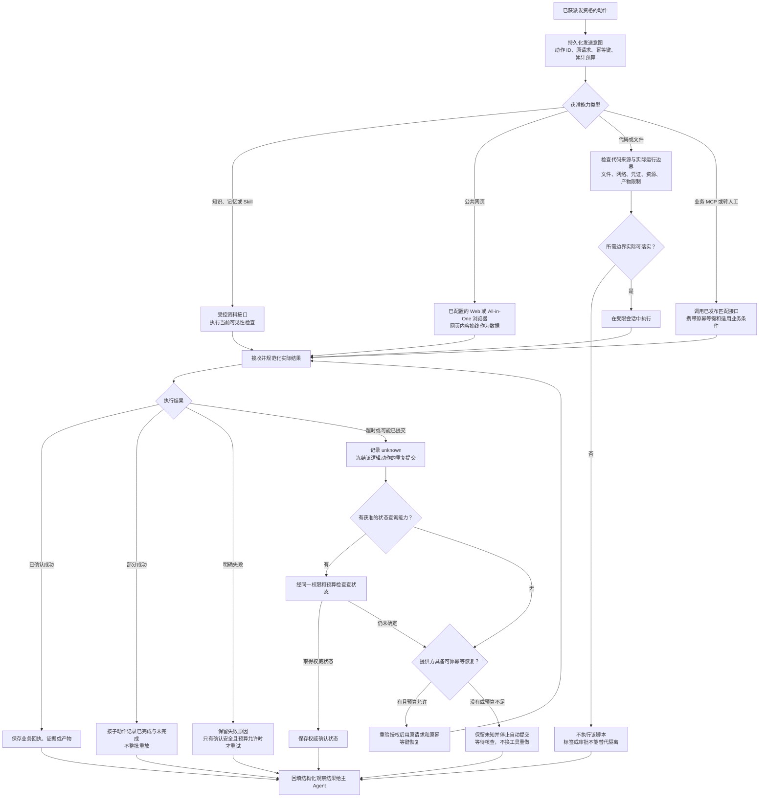
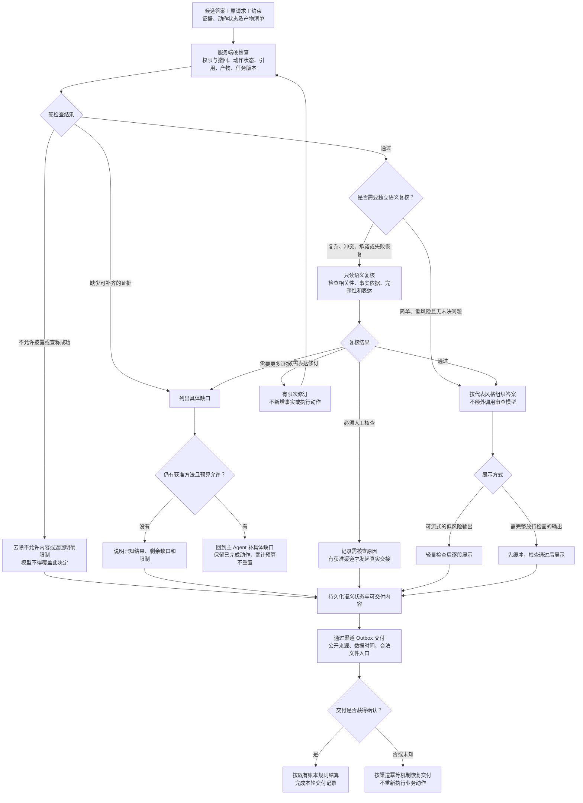
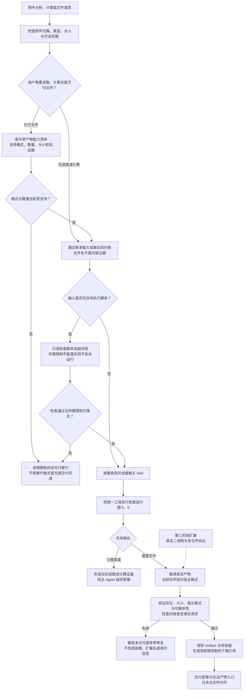
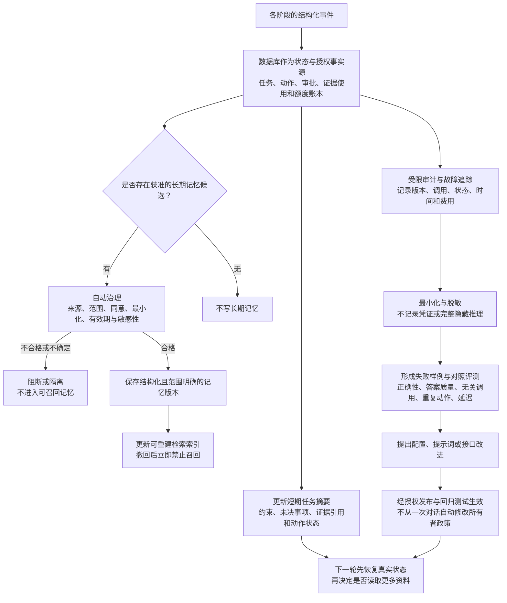

# Delegate 新架构：从用户输入到回答与执行

> 历史版本：最新完整流程见[目标架构 V2（2026-09-28）](agent-architecture-flow-v2.md)。本文保留讨论记录；入口控制、预算/恢复顺序、工具目录、最终核验和交付以V2及最新整改方案为准。

日期：2026-09-24。本文是目标架构，不是当前全部已上线的功能清单。复用已有 Pi 主循环、Broker、授权检索、数据库/Outbox、审批恢复、额度账本与 All-in-One；新增或改造任务理解、按需上下文、统一能力契约、分层复核及产物协议。

核心结构：一个主 Agent；服务端维护真实身份、任务、权限与操作状态；知识、记忆、Skill 和工具按任务加载；服务端硬校验始终执行，独立语义复核按需启用。

下图中的“识别、选择、规划、组织答案”是逻辑职责，同一主模型轮次可以承担多个职责，不表示每个方框都调用一次模型。路由只决定候选路径，不授予权限。所有会产生数据访问或外部效果的能力必须经过同一执行检查。

## 1. 整体主流程

这是三条路径：确定性控制请求不必调用模型；简单问答通常一次主模型请求；资料或行动任务在同一个 Agent 内循环。不存在所有问题固定经过“规划模型→执行模型→审查模型”的要求。

## 2. 新消息如何续接、修改和取消任务

任务版本不替代动作绑定。表示同意的一句话也不等于有效审批，审批主体必须由服务端认证。发生关键参数变化后，仍以配置中的 allow/ask/deny 和授权范围决定处理，不增加隐藏的强制审批。

## 3. 路径选择与每轮上下文组装

这些路径按任务需要组织，不是“股票/天气/地理”等关键词硬路由，也不固定 Web、MCP、浏览器的优先级。优先选择符合权限、对象、时效和输出要求的能力，在同等有效的方法中比较可靠性、成本与延迟。

上下文分为五层：稳定系统规则；已发布的代表身份/范围/性格；服务端最小运行状态；用户原请求；经过授权的证据、记忆、Skill 和工具结果。最后一层不提升为权限或系统指令。历史裁剪必须保留工具调用/返回配对、未决事项与关键动作状态。

当前未配置的独立 Web 搜索后端不注册给模型。公网浏览器可访问网页及搜索结果页，接入真实搜索服务后再扩展目录。

## 4. 知识与记忆：先授权、再取正文，支持有效证据复用

知识库绑定、联系人记忆和代表经验采用不同范围。跨渠道联系人记忆需要同一可信身份及有效同意；匿名访客保持渠道隔离。普通知识检索、缓存、发布快照 fallback 都不能绕过上述过滤。

## 5. 工具执行检查与审批恢复

只读、访问授权、需要审批和幂等是独立属性。旧审批不能因为任务 ID 相同就复用，也不能因为任务文字变动就一律失效；由服务端比较真实动作。仅改变回复排版不改变原动作，收件人、金额、对象等关键变化不得套用原审批。

服务端数据库事务只保证本地派发约束；外部恰好一次效果仍取决于提供方的幂等、状态查询和条件提交能力。

## 6. 执行、故障与结果未知恢复

当前 All-in-One 为公网模式，不能标成实例级禁网。浏览器 GET 也不能仅凭方法名就认定无副作用。执行成功只是本次工具/动作结果，是否完成用户全部目标还要进入图 7。

## 7. 主 Agent 停止条件、复核与交付

风险来自服务端能力、数据类型和实际动作，不能由模型一句“低风险”免检。简单问题不需要独立语义复核，但不绕过范围、权限与输出约束。需要放行前检查的正文必须先缓冲，不能依赖事后撤回已经展示的内容。

排队、业务执行、任务语义完成和消息送达分别记录：消息发送成功不等于用户任务完成，任务 partial 也不等于整个系统发生故障。

## 8. 附件和文件交付子流程

第一阶段收紧为当前经验证的单个文本/CSV/JSON；浏览器截图是另一项已存在的产物能力。PDF、XLSX及其他二进制、多文件能力在真实字节传输、解析验证与下载链路通过后才注册，不预先承诺。

## 9. 持久化、审计、记忆和评测反馈

联系人偏好与代表经验遵守现有自动记忆治理；不会新增日常记忆人工审批。访客自述可以记录为未验证偏好或信息，但不能成为身份或访问授权。临时行情、模型猜测和失败结果不能自动变成长期事实。

## 10. 服务落点及当前差异

| 层 | 服务或模块 | 复用 / 改造 |
| --- | --- | --- |
| 渠道入口与交付 | reps/web、Matrix/Telegram 适配器、Outbox | 复用可信入口、去重和交付；完善语义状态展示 |
| 任务与主循环 | conversation-worker、model-runtime/Pi | 复用单循环及恢复；补任务修订、候选路径与上下文选择 |
| 代表行为配置 | domain、representative-setup | 新增独立身份/回答范围/依据策略；行动权限复用 grants |
| 资料层 | web-data、MemoryUseRun、知识与记忆检索 | 强化正文前 ACL、证据条件、缓存复用和撤回检查 |
| 能力与执行 | capability-policy、compute-protocol、compute-broker | 统一分类、作用范围、审批绑定和端到端幂等 |
| 沙盒 | Tencent All-in-One | 复用真实浏览与代码环境；如实描述公网边界 |
| 输出 | 服务端 output gate、可选语义复核、Artifact | 硬检查常驻；语义复核按需；分期扩展文件格式 |
| 观测与优化 | 审计、账本、回归/eval | 区分真实完成、失败、未知、跳过与成本，不只统计工具调用 |

主要待新增/完善：统一任务分流；相关能力选择与发现；简单问答快速路径；证据复用；分层核验；独立业务范围配置；完整二进制/多文件协议。图中的目标机制不得理解为已经全部上线。

### 模型调用预期

| 场景 | 目标路径 | 是否固定加规划/复核模型 |
| --- | --- | --- |
| 状态查询、明确取消 | 服务端直接处理与回答 | 否；通常 0 次模型 |
| 问候、翻译、允许范围的一般解释 | 主模型直接回答＋必要硬检查 | 否；通常 1 次模型 |
| 指定知识问题 | 取得获准证据后回答；可复用有效证据 | 不固定；可在主循环中选择检索 |
| 公共查询 | 主模型选择相关工具，取得结果后回答 | 不固定；工具选择与回答通常需要多个轮次 |
| 附件、业务、多步骤 | 同一主 Agent 完成有依赖的步骤 | 仅复杂或高风险时增加语义复核 |

以上是目标路径，不是保证的固定调用次数。授权检查、来源查询和模型推理是不同操作，不应在指标中混为一谈。
