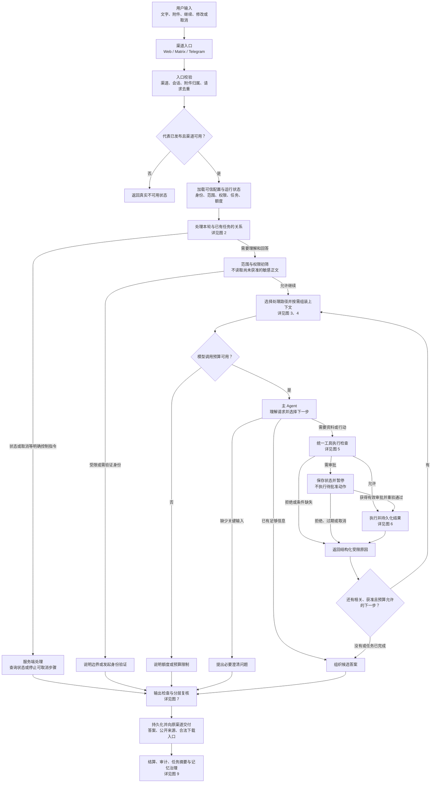
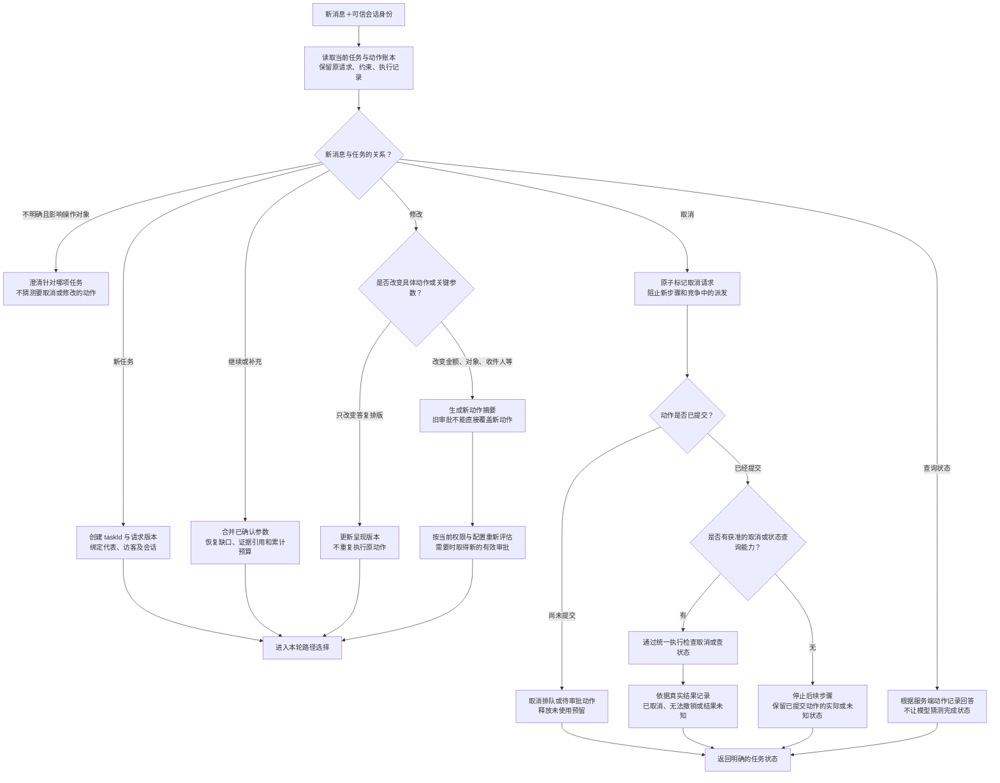
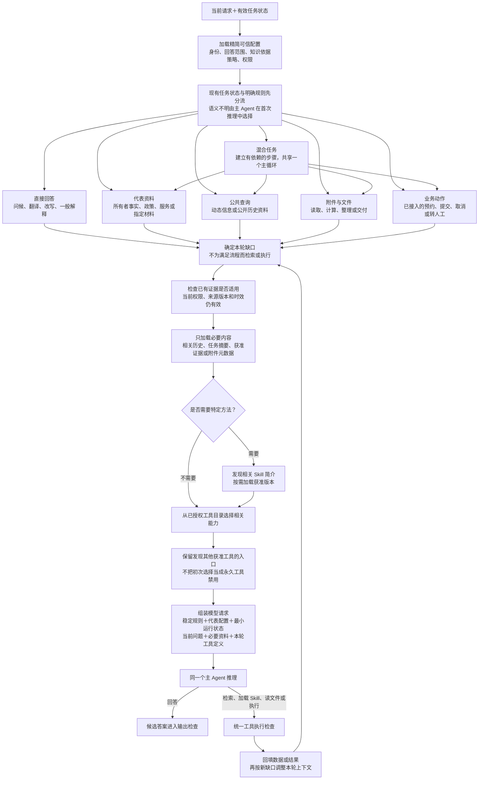
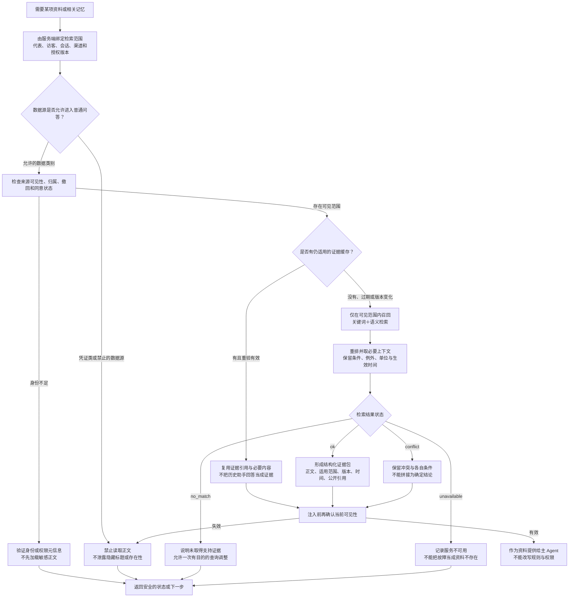
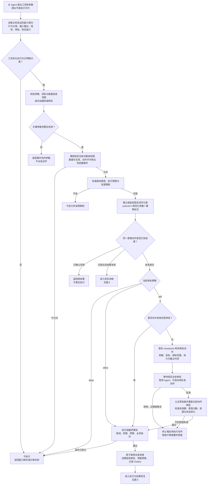
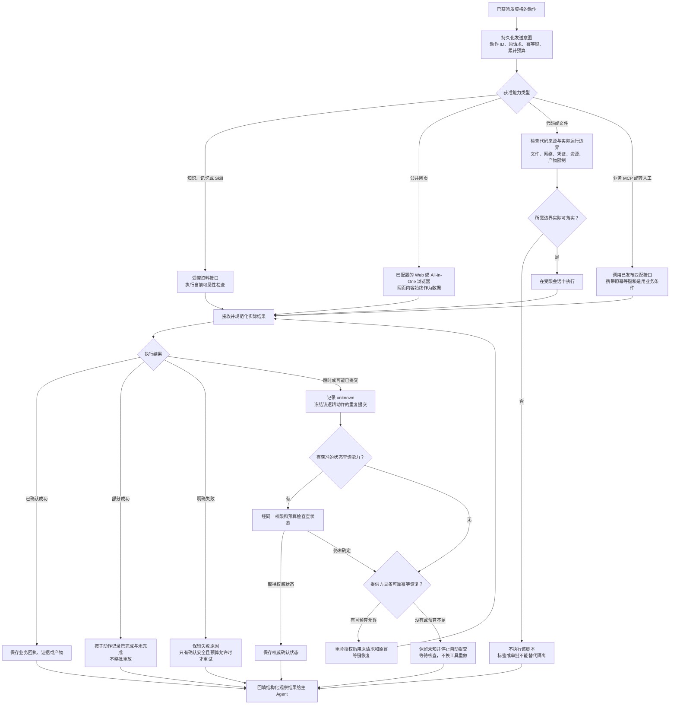
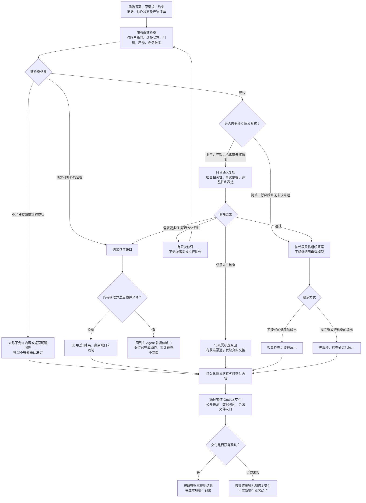
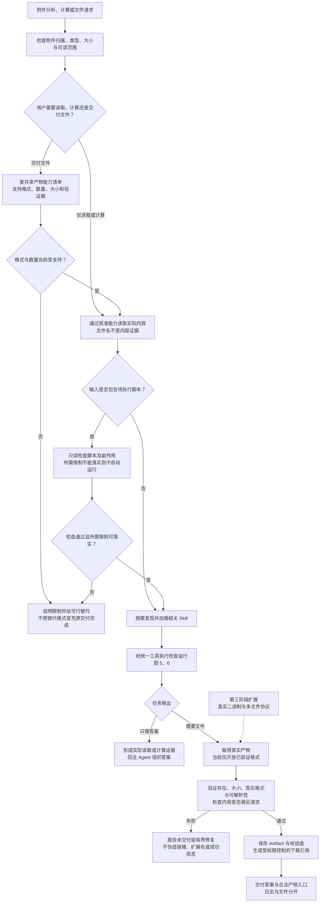
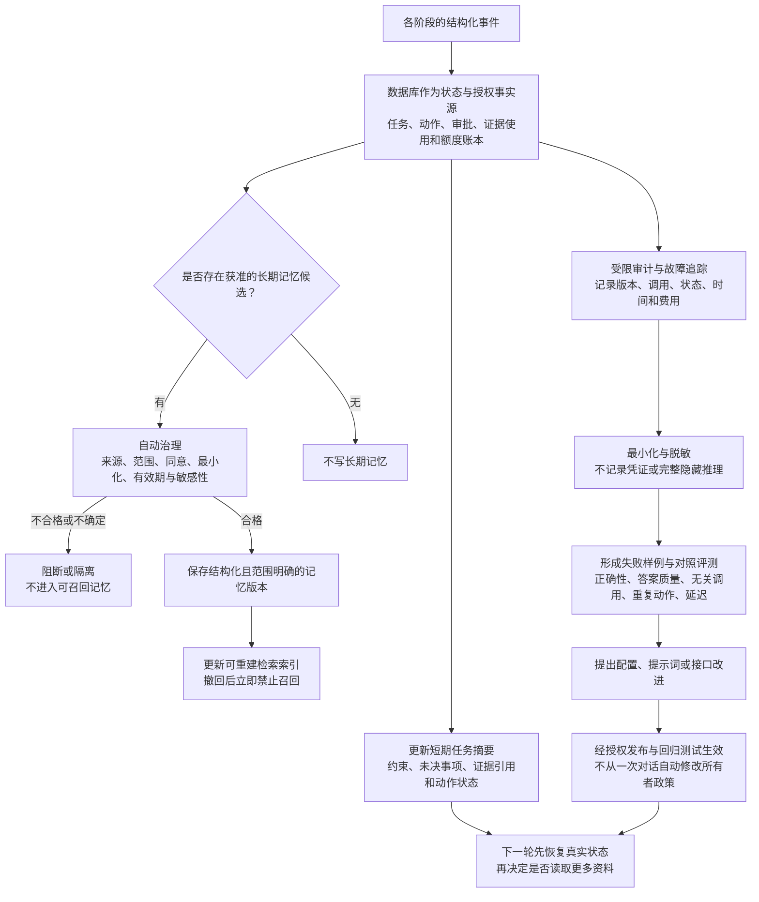

# 给外部 GPT 的 Delegate Agent 架构评审提示词

请从本文件开始阅读。你不需要知道此前聊天内容；本文件包含项目背景、当前实现、已确认需求、已知问题、评审任务，以及文末的完整目标架构流程图。

你是一名熟悉 LLM Agent、RAG、工具调用、异步工作流、权限控制和产品体验的架构评审者。请独立评估方案，指出真正影响正确性、可用性、成本与交付的缺口。不要仅复述方案或因为方案写得详细就赞同，也不要默认必须换模型、增加 Agent 或引入新的基础设施。

本次任务是评审，不是编写实现代码。请先基于已知事实完成评估；无法确认的内容标注为待验证，必要的问题放在最后。不要假称已经访问仓库、环境变量、云端控制台或执行了测试。

---

## 1. 项目介绍：Delegate 是什么

Delegate 是一个面向外部访客的 AI 接待与数字代表平台。个人或组织可以创建自己的数字代表，把代表发布到公开页面，让访客通过对话获得信息、提交需求或使用被授权的服务。

它的典型工作包括：

- 回答来自所有者已发布知识和材料的问题。
- 在配置允许的范围内，回答通用问题、查询公开信息。
- 分析附件、执行受控计算、生成当前支持的文件。
- 通过已经接入且授权的工具处理业务动作。
- 遇到需要批准的事项时暂停并等待相应主体审批。
- 需要人工服务时，真实创建转人工请求并说明实际状态。
- 按既有免费额度/消费额度规则提供服务，记录预留、结算和释放。

数字代表不是所有者本人，也不是把所有者的私人助手直接开放给陌生人。它只能在所有者与平台允许的范围内对外提供服务。

例如，一个所有者可以创建“地理教学代表”。该代表的性格可以是耐心、善于解释机制；专业领域可以是初中地理；回答范围可以允许通用公开问答；可执行动作则由另外的工具授权决定。地理身份不应自动把股票问题改成天气问题，也不应自动赋予代表读取所有者私有资料的能力。

### 使用者及边界

- **Owner / 所有者**：创建代表、发布资料和配置、授予服务范围内的能力、处理其负责的审批。
- **Visitor / 外部访客**：提问、上传附件、补充参数、修改或取消自己的任务，使用本人可访问的数据与额度。
- **Operator / 人工服务人员**：在被授权范围内接管会话或处理事项。
- **平台服务端**：验证可信身份、资料范围、权限、审批、预算及真实执行状态。

“能够回答”“能够读取资料”“能够执行动作”“能够代表所有者承诺”是不同权限。访客自称员工或老板，不构成可信身份。

## 2. 当前技术与已有组件

这是已有系统上的增量整改，不是从零开发。以下信息由项目方提供，截至 2026-09-24；你没有源码访问能力时，应将其作为待评审的工程事实摘要，而非自行验证过的结论。

| 部分 | 当前基础 |
| --- | --- |
| 语言和应用 | TypeScript / Node.js，Web 页面与后台，monorepo |
| 公开入口 | Web 优先；已有 Matrix、Telegram 相关适配基础，不能推断其他渠道全部上线 |
| 主模型运行时 | Pi 单一 Agent 循环，项目依赖 `@earendil-works/pi-agent-core@0.85.1`、`@earendil-works/pi-ai@0.85.1` |
| 模型接入 | 可配置提供方；一次本机请求样本使用 `qwen-plus`，经配置的兼容接口接入。不是对所有部署的永久模型约定 |
| 会话执行 | conversation-worker，GenerationRun、Outbox、工作租约、事件和交付记录 |
| 工具执行 | Compute Broker，承接 exec/read/write/process/browser 等受治理能力，并接入 MCP |
| 数据与持久化 | Prisma / PostgreSQL；任务、审批、操作记录、产物、账本及审计 |
| 知识与记忆 | PostgreSQL 作为治理事实源，OpenViking 作为可重建检索投影；知识、联系人记忆、代表经验分层 |
| Skills | 已发布/已绑定的版本化方法说明，存在发现和加载入口；加载不等于执行 |
| 沙盒 | 本机已经接入腾讯云 All-in-One，使用公网模式，真实浏览器调用已验证 |
| 文件与下载 | 已有 Artifact 存储及受权限控制的下载机制；当前 Pi 代码交付链路仍主要靠 stdout 重建单个文本文件 |
| 收费 | 已有消费额度预留、结算、释放及相应账本；本次不重设计支付、价格或分账系统 |

重要：当前使用的 `delegate-aio-pi-v1` 工具为 PUBLIC 模式。2026-09-23 的迁移实测中，无法通过所用 E2B 参数或实例元数据将其 AIO 实例限制为禁网。这是当前工具、账号、地域及接入链路的实测边界，不代表腾讯云所有沙盒都不支持禁网。官方文档提供工具级 SANDBOX/VPC 网络模式，实例继承工具配置；另有按灰度开放的 NetworkPolicy。是否能为本账号的 AIO 另建隔离工具或启用细粒度策略，尚需验证。不能把未生效的限制当成已具备；挂载、凭证和资源边界也需分别核验。参考：[腾讯云网络模式](https://cloud.tencent.com/document/product/1814/132216)、[产品动态](https://cloud.tencent.cn/document/product/1814/123809)。

## 3. 当前 Agent 实际怎么工作

### 3.1 当前主链路

当前不是每轮把所有能力执行一遍，而是：

1. 服务端加载代表配置、权限、有限近期上下文，并进行知识元数据探测。
2. 将本轮已配置且可暴露的工具目录提供给主模型。
3. 由主模型决定直接回答还是调用工具。
4. 工具调用由适配器/Broker 执行，结果回传同一主 Agent。
5. 新的 `goal_v2` 正常生成候选答复后通常进行独立语义核验，可能要求有界补证或修订。

当前尚未形成统一的“按任务选择上下文、首批工具和复核方式”的机制。已有状态查询、取消、明确转人工等特殊分支；不是完全没有分流，但也不是完整的任务路由。

### 3.2 一次首轮请求的具体样本

场景：新会话、无附件，用户问“查下阿里今天的股票如何”。

- 2 条消息：system + user。
- 系统提示词约 9,827 个字符。
- 请求体约 23,796 字节，字节数不是 Token 数。
- 首轮包含 10 个工具定义，含名称、说明和参数结构。
- 首轮没有长期记忆正文、Skill 正文、网页结果和工具执行结果。
- 这只是一份请求样本，不能由此推断模型已经选错工具，或所有问题都具有相同上下文规模。

本轮工具名：

```text
retrieve_authorized_knowledge
mcp__deepwiki__read_wiki_contents
mcp__deepwiki__read_wiki_structure
mcp__open-meteo__openmeteo_get_forecast
mcp__open-meteo__openmeteo_search_locations
discover_skills
load_skill
browse_in_sandbox
execute_in_sandbox
request_human_handoff
```

MCP 当前最多暴露 32 个定义。知识、记忆和 Skill 正文按需加载，并非全量注入。近期上下文也有限制；目前没有完善的“携带有效证据引用的任务摘要”代替简单历史裁剪。

### 3.3 最近已经完成的增量修复

- 保留主 Agent，以原问题与工具观察进行相关性/完成核验。
- 浏览器记录 HTTP 状态、可见内容和获取时间，错误页/空内容不应被当成有效结果。
- 审批 checkpoint 保存原生工具调用 ID、观察记录、已用步骤及部分使用量；恢复时可继续使用同类工具处理后续步骤。
- 防止旧审批回调覆盖新的待审批动作。
- 增加结果未知时停止部分不安全重试的处理。
- 修复等待审批的任务无法通过持久化状态取消的问题。
- 真实验证过 All-in-One 网页读取、两个网页分别审批后续接、待审批取消。

这些是已有基础，不能据此认定所有权限、脚本、幂等、恢复和回答质量问题都已解决。既有自动化套件通过，也不是新架构已经全部实现或没有漏洞的证明。

## 4. 真实问题与整改动因

曾出现以下现象：

1. 用户问股票，答案变成语法解释，或调用天气工具后回答总部所在地天气。
2. 用户明确要求浏览器，模型仍可能选择无关 MCP，或声称缺少金融专用 API 而不尝试公开网页。
3. 网页加载完成但实际是 429、空白页、错误链接，却容易被误认为任务已经完成。
4. 审批后恢复曾删除整类沙盒工具，导致下一步无法继续浏览。
5. 配置“默认放行”但仍被额外强制审批或已废弃 PASS 门槛阻挡。
6. 简单问题也可能增加一轮语义复核，影响成本和延迟。
7. 提示词叠加了相互冲突的强制规则。
8. 工具能力声明与真实产物交付协议不完全一致。

我们不希望针对股票、天气、旅游等每个行业增加单独的关键词分支或专用工具。允许使用已有适配的业务工具，但公共问题应能由通用公开查询和浏览器能力处理。

## 5. 当前仍需解决的具体缺口

### 5.1 提示词冲突

已发现的旧规则包括：

- 将最新用户请求称为 immutable goal，未明确授权边界和合法修改/取消。
- 要求组织事实、内部凭证等问题在回答、拒绝或澄清之前先检索。
- 要求专业领域常识也必须检索。
- 要求动作请求必须调用工具，未统一表述授权、参数、审批和能力前提。
- 要求修复上传脚本时先原样执行。
- 公开搜索仅限“当前”信息，却又允许查询公开历史资料。
- 正文不得列知识来源标题，与简短事实答复必须包含实际来源标题冲突。
- 只有本轮工具成功返回的来源名称才可提及，误伤用户提供的名称和经过重新验证的旧证据。

需要同步整理系统提示词、工具说明、代表配置、服务端校验与核验器，而不只修改其中一处。

### 5.2 代码残留的已知片段

基线为提交 `2168618` 加本地未提交改动，以下是工作区复核片段，不声称全部存在于该提交原文，也不凭片段认定已经发生越权。

MCP 目录阶段已经尝试使用服务端分类：

```ts
const readOnly = policy?.effect.mutation === "none";
```

但调用适配器仍有：

```ts
callTool: async ({ server, tool, arguments: toolArguments }) => {
  const result = await executeMcp({
    // 其他字段略
    readOnly: !binding.approvalRequired,
  });
}
```

Broker 另有服务端校验，因此不能据此断言所有授权都被绕过。需要核对属性一致性、返回处理和端到端幂等键传递；上游生成幂等键，不代表下游已经使用。

代码执行请求固定标记：

```ts
compiledTask: {
  compilerVersion: "sandbox-task-compiler.v1",
  instructionHash: sha256Text(userText.trim()),
  codeHash: sha256Text(source),
  riskClass: "self_contained_compute",
  compilerProvider: "delegate-pi-runtime",
}
```

已有验证主要检查请求文本和代码 hash 的一致性。内容一致性不能证明没有外部副作用，也不能替代实际沙盒隔离。

### 5.3 其他明确边界

- 独立通用 Web 搜索服务尚未配置；浏览器可以访问公开网页/搜索结果页。不得注册不存在的搜索后端。
- 当前 `goal_v2` 工具主要串行执行，审批屏障、预算和安全读取并发的关系仍需完善。
- 当前代码文件交付主要是单个文本产物；不能以改扩展名支持 XLSX/PDF 等二进制。
- 普通知识结果主要注入摘要，是否保留足够条件、单位、例外和日期需要验证。
- 当前历史压缩偏重消息数量截取，需保证工具调用/返回配对和未决动作记录不丢失。
- 审批恢复累计的活跃时间主要是 Agent 进程工作时间；批准后的 Broker 独立执行时间没有统一为一个跨服务总时钟。
- 不承诺任意崩溃点、任意外部 shell 副作用的“恰好一次”。

## 6. 已确认的产品需求与不能忽略的约束

### 6.1 核心行为

保留三项设计：数字代表身份明确；行动与交付有真实证据；检索未命中不等于事实不存在。

有效请求应在平台规则、所有者授权及当前访客权限内执行。用户可以修改或取消任务，不能通过对话增权。网页、附件、知识、工具返回、历史对话及普通上传的规则文件均不能改写权限。

### 6.2 独立配置

身份、回答范围、知识依据策略、行动权限和代表所有者承诺的范围分别配置。“专属代表/开放问答/事务代理”可作为预设，不应成为互斥权限模型。

本机测试代表需要能够处理跨领域公开查询。人设影响表达，不能把用户问题擅自换成更符合人设的主题。其他代表不在迁移中被自动扩权。

### 6.3 知识与记忆

- 所有者特定事实、政策、价格、观点和承诺需要授权依据。
- 指定课程/教材口径取对应资料；一般稳定知识能否直接回答由配置决定。
- 公开动态与历史信息允许使用相关公开能力；私有订单、账户标识不能随意发送到公共搜索。
- 凭证类资料不进入普通问答检索；不能因“内部”关键词一律拒绝可能获准的政策/订单查询。
- 权限范围由服务端绑定，过滤发生在正文检索/注入前，缓存和 fallback 同样受限。
- 已有适用证据可复用，但须重验权限、来源版本及有效期；不能把历史模型答案直接当证据。
- 联系人记忆按访客和代表隔离；跨渠道连续性需要可信身份与有效同意。
- 日常长期记忆采用现有自动治理，不要新增所有者逐条审批记忆的流程。
- 失败结果、猜测和临时行情不能自动成为长期事实。

### 6.4 工具与审批

- read/write/unknown、访问授权、审批主体、幂等和恢复能力独立管理。
- 未分类工具不能默认只读，也不能靠一个确认弹窗直接放行。
- 既有 allow/ask/deny 在其授权范围内生效；不要再暗中强制所有浏览器审批。
- 审批绑定具体工具/动作/对象/关键参数/授权范围，并检查期限、使用规则及适用业务条件。
- 改收件人、金额或对象，旧审批不能直接复用；只改答复排版通常不影响原动作。
- 用户确认不能替代所有者或管理员授权。
- queued、accepted、HTTP 200 不等于业务成功。
- 超时后查询状态或使用原幂等机制恢复；没有可靠恢复依据时保留 unknown，不换工具重复提交。

### 6.5 沙盒与产物

继续使用腾讯 All-in-One。其公网能力与限制必须如实描述。上传脚本先检查；无法落实所需边界时不能用风险标签冒充安全证明。

立即按实际能力收紧文件承诺；随后扩展真实字节传输、二进制、多文件及内容核验。要求“生成 XLSX”时，不能悄悄交付 CSV 并宣称完成原任务。

### 6.6 商业与体验

- PASS/Deep Help 的计算能力门槛已经废弃，不能重新引入。能力使用按现有消费额度、授权和审批处理；有额度也不自动获得所有者私有数据权限。
- 不在本次重写支付或分账规则；重点保证动作/交付重试不会重复收费，未使用预留按既有规则释放。
- 简单问题不固定多走规划和审查模型。
- 只有影响正确答案或行动的重要歧义才追问；能够低成本并列回答时可说明假设后继续。
- 性格通过解释方式、措辞和深度体现，不机械介绍身份或每次追加推销。
- 需要输出前检查的敏感正文先缓冲；不能靠事后审查撤回已流出的内容。

## 7. 待评审的目标架构摘要

采用一个主 Agent，服务端统一控制访问与执行，知识、记忆、Skills 和工具按任务加载。图中的逻辑步骤不表示每个方框都调用一次模型。

主链路：

用户输入 → 可信入口与任务恢复 → 范围/权限初筛 → 按任务选择上下文和首批能力 → 主 Agent 直接回答或提出调用 → 统一执行检查 → 实际执行与状态持久化 → 对照原请求判断缺口 → 必要时继续 → 硬检查及按需语义复核 → 持久化交付 → 账本/审计/记忆治理。

关键设计：

1. 明确状态和取消请求可走确定性路径，通常不需要模型。
2. 允许范围内的简单文本任务通常一次主模型请求；不固定增加独立路由/审查调用。
3. 工具任务在同一 Pi 循环中进行，按依赖顺序推进。
4. 相关性筛选只影响候选工具，不授予权限；保留发现其他已授权工具的入口。
5. 工具声明、执行校验和输出能力说明来自统一的版本化能力定义。
6. 审批/动作/未知结果/预算由服务端持久化，不能靠追加“已批准”提示词实现。
7. 硬检查常驻；语义复核按实际数据、动作、冲突、承诺和恢复状态决定。
8. 任务完成、外部动作完成、消息送达、消费结算分别记录。

候选数据契约：

- **RepresentativeBehavior**：身份、回答范围、知识依据策略、承诺范围，引用已有行动授权。
- **TaskState**：taskId、原请求、请求修订、呈现修订、约束、交付物、缺口、证据引用、累计预算。
- **CapabilityDescriptor**：用途、schema、行为分类、数据发送边界、授权、审批、幂等、状态查询、取消及产物能力。
- **ActionEnvelope**：稳定动作 ID、工具和版本、规范化参数、目标对象、可信主体、授权依据、业务前置条件、幂等标识。
- **ExecutionObservation**：实际状态、证据/产物、时间、失败原因及 unknown；不由模型自行确认业务成功。
- **EvidenceReference**：内容来源、版本、范围、适用条件、有效期、公开引用和撤回状态。

这些是拟议契约，不表示现有数据库和接口已经完整支持。

## 8. 请重点回答的问题

请审查完整流程图，而不只看主提示词。以下问题需要明确判断、取舍和建议实现位置。

### A. 架构与复杂度

- 一个主 Agent 是否足够？哪些职责应留在普通代码/数据库事务中？
- 图中的路由、上下文选择、规划是否存在职责重复或隐含额外模型调用？
- 当前只有约 10 个工具的情况下，怎样按需暴露工具才不会比全量目录更慢、更不稳定？
- 什么时候才值得增加独立路由或独立复核？用什么数据作决定？

### B. 上下文和证据

- 如何先判断资料需求，又避免为了裁剪工具新增固定前置模型调用？
- 主 Agent 尚不知道工具细节时，如何发现合适能力、纠正初次误选？
- 证据如何跨轮复用，同时保证权限撤回、受众变化、版本与时效正确？
- 如何按完整工具交互压缩历史，避免保留成功摘要却丢失证据？
- 现有“以摘要为主”的知识结果在哪些任务不足？怎样改结构、分块和重排？

### C. 权限、审批和外部执行

- 请区分确定性可校验的权限条件与只能由模型辅助理解的语义条件。
- ActionEnvelope 和审批摘要应包含什么？哪些字段变化必须重新评估？
- 如何避免权限检查与真正提交之间的状态变化造成错误？哪些保证依赖外部系统？
- 任意代码在公网沙盒中运行时，哪些限制可真实执行，哪些只能作为检查线索？
- unknown 如何阻止主 Agent 换工具重复完成同一逻辑动作？
- 如何区分“同一个动作重试”和“用户确实要求再次执行相同参数的新动作”？
- 取消、批准、派发、结果回调并发时，最小必要状态和事务约束是什么？

### D. 输出质量、成本及交付

- 哪些输出可以一次模型直接回答，哪些需要缓冲、硬检查或额外语义复核？
- 如何防止模型说“无需证据”就绕过需要实际数据的任务核验？
- 如何避免“缺少专用 API”成为放弃通用浏览能力的借口，也避免无限访问错误链接？
- 部分完成、等待用户、等待审批、执行未知、交付未知如何分别表达和收费？请沿用现有商业规则，不凭空设计新价格。
- 真实产物核验如何分阶段实现，哪些能力承诺必须立即撤回或收紧？
- 稳定地理解释、所有者政策和股票查询应如何分别提供清楚有用的答案？

### E. 实施与验证

- 请指出最小可行改造，避免把所有候选契约变成新的微服务。
- 哪些必须同时改，哪些可分阶段？如何兼容现有审批和运行中的任务？
- 如何设计新旧提示词、正确证据替换、上下文精简、模型对比这四类实验？
- 如何使用真实任务盲评，而不是只让同一个模型评价自己的答案？
- 哪些验收必须检查实际数据访问、动作和账本，不能只检查最终文本？

## 9. 期望输出格式

请用中文给出可以用于实施决策的评审报告。先说结论，再给证据和方案。不要只写“建议加强权限、完善监控、优化提示词”之类无法执行的建议。

请依次提供：

1. **总体结论**：可直接实施 / 修正后实施 / 需要重大调整；说明最重要的理由。
2. **保留、修改、删除、暂缓清单**：每项注明原因和实际收益。
3. **问题表**：优先级、对应流程节点、触发条件、后果、修正办法、验收方法；区分材料已确认、架构推断和需要源码验证。
4. **修订后的主流程**：给出可解析的 Mermaid；必要时拆成整体、权限/审批、结果恢复几张图，不把所有边都挤进一张。
5. **关键契约与状态**：给最小字段和状态迁移，标注服务端、模型、外部提供方分别负责什么。伪代码必须标成伪代码。
6. **分阶段实施清单**：按依赖排序，写出涉及的现有模块、兼容策略、回滚条件与每阶段发布门槛。
7. **决策验收案例**：至少覆盖下列场景，每项说明预期决策、允许/禁止的实际行为、最终答复和必要故障注入。
8. **性能与成本验证**：区分明确控制指令、简单文本、公开查询、附件、多步骤动作，不编造尚未测量的延迟或准确率。
9. **待确认问题**：只列真正会改变架构决定的少量问题，并给出暂时采用的合理假设。

必须覆盖的验收场景：

- 问候、翻译、稳定的一般解释。
- 指定课程口径与所有者价格/政策。
- 股票查询和公开历史资料，无关天气 MCP 同时存在。
- 同一访客要求把上一条答复缩短；之后资料权限被撤回。
- 访客自称所有者并索要密钥；经验证的访客查询本人业务记录。
- 网页/附件/Skill 含有要求改权限或外传数据的指令。
- 无需审批的写操作；需要审批的只读资料访问；行为分类未知。
- 审批后修改收件人/金额；只修改答复格式。
- 工具已提交后断线；查询暂未查到；幂等接口不可用。
- 取消、审批通过和派发发生竞争；旧回调晚于第二次审批。
- 上传脚本含外部写入、凭证访问或破坏性操作。
- 请求不支持的文件格式；文本伪装二进制；文件不可下载。
- 转人工只返回 queued；部分步骤成功；渠道交付未知。
- 跨访客记忆隔离及多来源冲突。

## 10. 评审时的事实和推理边界

- 文末流程图是待实施方案，不是现状说明；不要把图中的节点都算作已经实现。
- 文件中的项目事实由我们提供；没有源码/运行证据时，不要声称独立验证过。
- 小样本和已有套件通过不能证明新架构无漏洞，也不能把明确的工程缺口说成已经发生的攻击。
- 若具备浏览能力，可核对官方资料；优先依据本项目锁定版本，公开 main 文档不能当作当前 SDK 签名。没有浏览能力时注明即可。
- 不建议仅靠关键词过滤、模型自报权限、审批弹窗或静态风险标签作为安全边界。
- 不许用任意缓存答案绕过撤回，也不要把全部历史、记忆、Skills 和工具每轮重新塞给模型。
- 不要求暴露模型完整隐藏推理；用简短决策代码、输入输出与真实执行状态证明行为。
- 不要因为我们倾向单 Agent 就回避反例；如果你认为某处需要其他设计，说明具体收益、代价和可验证依据。

下面是本次需要你评审的完整目标架构。请结合前面的现状、需求和约束阅读。

---

# 附录：完整目标架构流程图

# Delegate 新架构：从用户输入到回答与执行

日期：2026-09-24。本文是目标架构，不是当前全部已上线的功能清单。复用已有 Pi 主循环、Broker、授权检索、数据库/Outbox、审批恢复、额度账本与 All-in-One；新增或改造任务理解、按需上下文、统一能力契约、分层复核及产物协议。

核心结构：一个主 Agent；服务端维护真实身份、任务、权限与操作状态；知识、记忆、Skill 和工具按任务加载；服务端硬校验始终执行，独立语义复核按需启用。

下图中的“识别、选择、规划、组织答案”是逻辑职责，同一主模型轮次可以承担多个职责，不表示每个方框都调用一次模型。路由只决定候选路径，不授予权限。所有会产生数据访问或外部效果的能力必须经过同一执行检查。

## 1. 整体主流程



这是三条路径：确定性控制请求不必调用模型；简单问答通常一次主模型请求；资料或行动任务在同一个 Agent 内循环。不存在所有问题固定经过“规划模型→执行模型→审查模型”的要求。

## 2. 新消息如何续接、修改和取消任务



任务版本不替代动作绑定。表示同意的一句话也不等于有效审批，审批主体必须由服务端认证。发生关键参数变化后，仍以配置中的 allow/ask/deny 和授权范围决定处理，不增加隐藏的强制审批。

## 3. 路径选择与每轮上下文组装



这些路径按任务需要组织，不是“股票/天气/地理”等关键词硬路由，也不固定 Web、MCP、浏览器的优先级。优先选择符合权限、对象、时效和输出要求的能力，在同等有效的方法中比较可靠性、成本与延迟。

上下文分为五层：稳定系统规则；已发布的代表身份/范围/性格；服务端最小运行状态；用户原请求；经过授权的证据、记忆、Skill 和工具结果。最后一层不提升为权限或系统指令。历史裁剪必须保留工具调用/返回配对、未决事项与关键动作状态。

当前未配置的独立 Web 搜索后端不注册给模型。公网浏览器可访问网页及搜索结果页，接入真实搜索服务后再扩展目录。

## 4. 知识与记忆：先授权、再取正文，支持有效证据复用



知识库绑定、联系人记忆和代表经验采用不同范围。跨渠道联系人记忆需要同一可信身份及有效同意；匿名访客保持渠道隔离。普通知识检索、缓存、发布快照 fallback 都不能绕过上述过滤。

## 5. 工具执行检查与审批恢复



只读、访问授权、需要审批和幂等是独立属性。旧审批不能因为任务 ID 相同就复用，也不能因为任务文字变动就一律失效；由服务端比较真实动作。仅改变回复排版不改变原动作，收件人、金额、对象等关键变化不得套用原审批。

服务端数据库事务只保证本地派发约束；外部恰好一次效果仍取决于提供方的幂等、状态查询和条件提交能力。

## 6. 执行、故障与结果未知恢复



当前 All-in-One 为公网模式，不能标成实例级禁网。浏览器 GET 也不能仅凭方法名就认定无副作用。执行成功只是本次工具/动作结果，是否完成用户全部目标还要进入图 7。

## 7. 主 Agent 停止条件、复核与交付



风险来自服务端能力、数据类型和实际动作，不能由模型一句“低风险”免检。简单问题不需要独立语义复核，但不绕过范围、权限与输出约束。需要放行前检查的正文必须先缓冲，不能依赖事后撤回已经展示的内容。

排队、业务执行、任务语义完成和消息送达分别记录：消息发送成功不等于用户任务完成，任务 partial 也不等于整个系统发生故障。

## 8. 附件和文件交付子流程



第一阶段收紧为当前经验证的单个文本/CSV/JSON；浏览器截图是另一项已存在的产物能力。PDF、XLSX及其他二进制、多文件能力在真实字节传输、解析验证与下载链路通过后才注册，不预先承诺。

## 9. 持久化、审计、记忆和评测反馈



联系人偏好与代表经验遵守现有自动记忆治理；不会新增日常记忆人工审批。访客自述可以记录为未验证偏好或信息，但不能成为身份或访问授权。临时行情、模型猜测和失败结果不能自动变成长期事实。

## 10. 服务落点及当前差异

| 层 | 服务或模块 | 复用 / 改造 |
| --- | --- | --- |
| 渠道入口与交付 | reps/web、Matrix/Telegram 适配器、Outbox | 复用可信入口、去重和交付；完善语义状态展示 |
| 任务与主循环 | conversation-worker、model-runtime/Pi | 复用单循环及恢复；补任务修订、候选路径与上下文选择 |
| 代表行为配置 | domain、representative-setup | 新增独立身份/回答范围/依据策略；行动权限复用 grants |
| 资料层 | web-data、MemoryUseRun、知识与记忆检索 | 强化正文前 ACL、证据条件、缓存复用和撤回检查 |
| 能力与执行 | capability-policy、compute-protocol、compute-broker | 统一分类、作用范围、审批绑定和端到端幂等 |
| 沙盒 | Tencent All-in-One | 复用真实浏览与代码环境；如实描述公网边界 |
| 输出 | 服务端 output gate、可选语义复核、Artifact | 硬检查常驻；语义复核按需；分期扩展文件格式 |
| 观测与优化 | 审计、账本、回归/eval | 区分真实完成、失败、未知、跳过与成本，不只统计工具调用 |

主要待新增/完善：统一任务分流；相关能力选择与发现；简单问答快速路径；证据复用；分层核验；独立业务范围配置；完整二进制/多文件协议。图中的目标机制不得理解为已经全部上线。

### 模型调用预期

| 场景 | 目标路径 | 是否固定加规划/复核模型 |
| --- | --- | --- |
| 状态查询、明确取消 | 服务端直接处理与回答 | 否；通常 0 次模型 |
| 问候、翻译、允许范围的一般解释 | 主模型直接回答＋必要硬检查 | 否；通常 1 次模型 |
| 指定知识问题 | 取得获准证据后回答；可复用有效证据 | 不固定；可在主循环中选择检索 |
| 公共查询 | 主模型选择相关工具，取得结果后回答 | 不固定；工具选择与回答通常需要多个轮次 |
| 附件、业务、多步骤 | 同一主 Agent 完成有依赖的步骤 | 仅复杂或高风险时增加语义复核 |

以上是目标路径，不是保证的固定调用次数。授权检查、来源查询和模型推理是不同操作，不应在指标中混为一谈。
