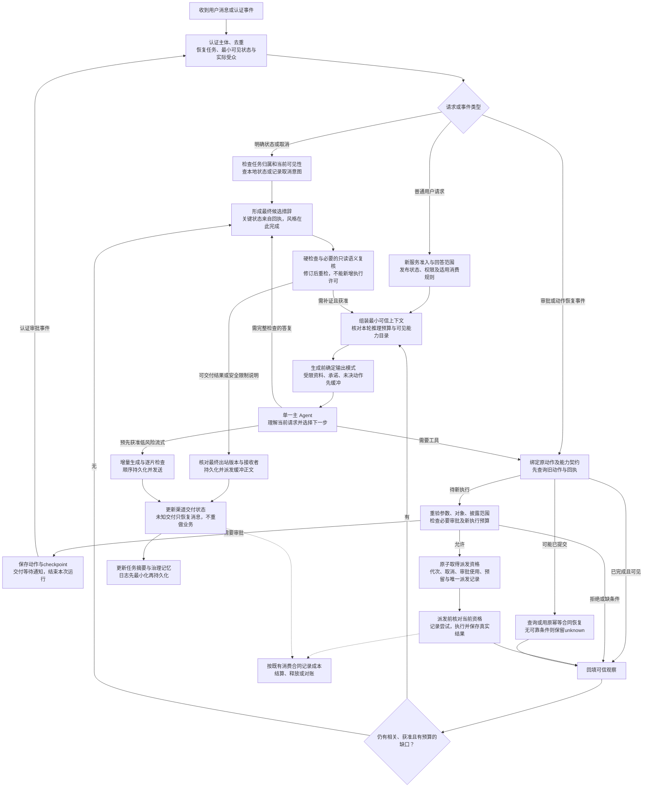

# Delegate Agent 最终整改实施方案

版本：V2.1，2026-09-28。状态：实施中，已落地子项见[实施验收记录](agent-implementation-progress.md)；尚未部署。

优先级、工期和最新交付顺序见[最终修改优先级与交付计划](agent-priority-and-delivery-plan.md)。技术约束沿用本文，分组编号不再代表全部串行实施。

完整主链路及分支见[目标架构 V2：从用户输入到最终交付](agent-architecture-flow-v2.md)。

依据：[架构自检报告](reviews/delegate-architecture-selfcheck.md)、当前工作区调用链和测试证据，以及前几轮产品需求。基线为 `2168618480d965bdb2c37978a9dd5ff182b2ff62` 加自检记录中的未提交修改；实施前重新核对漂移。

本文作为下一轮实施依据；先前提示词方案及九张图保留为历史讨论资料。涉及顺序冲突时以本文为准。14个失败探针是合成条件下未满足的断言，不等于14起事故；没有把尚未验证的风险当成已发生的越权。

## 1. 最终决定

继续采用一个 Pi 主 Agent，复用 conversation-worker、Compute Broker、PostgreSQL、Outbox、审批、MemoryUseRun、Artifact 和既有额度账本。

本轮同步推进必要的正确性边界与可感知的回答改善；简单路径、公开查询和真实模型对照提前实施，完整动作/资料恢复按相关能力验收。当前约10个工具不构成立刻增加独立路由模型或动态目录裁剪的证据。新增契约优先落在现有 TypeScript 类型、表字段和事务中，不拆成一组新服务。

保留：数字代表身份明确；行动/交付必须有真实依据；未命中不等于不存在。保留已验证的等待审批通知、恢复重验、旧回调保护、资料出站栅栏、轻量知识读取、额度之前的本地状态控制、Artifact写前清洗和账本幂等。

本轮不恢复PASS/Deep Help门槛，不增加浏览器一律审批，不重设计支付/退款/分账规则，不把公开问答按行业拆成大量专用工具。截图是浏览器的既有能力，不代表代码工具已支持任意图片文件。

## 2. 修正后的主流程

图是逻辑顺序，不意味着每个节点调用一次模型。普通知识/Skill读取只做适用的授权、来源检查与必要记录；不强制建立外部动作Outbox。需要审批、外部效果或异步恢复的能力使用持久动作路径。

低风险流式资格在生成前确定；不能先生成完整答案再分段播放，却宣称优化了模型首片延迟。审批/恢复事件直接绑定服务端已保存动作，不要求模型重新规划才能执行原批准动作。所有恢复、补证和修订共享累计预算与停止条件。

## 3. 核心数据约定：语义优先，复用现有实现

| 概念 | 最小职责与字段语义 | 实施要求 |
| --- | --- | --- |
| 代表行为配置 | 身份、回答范围、知识依据策略、承诺范围、行动grant引用、版本 | 与性格分开；已有公开问答/权限不因迁移自动扩大 |
| 任务与意图 | 原消息事件、原请求、有效修改、任务/呈现修订、交付要求、证据义务、动作引用、预算 | 新消息不必新任务；但新的明确业务效果不能仅靠相同参数合并 |
| 能力契约 | 版本、参数、read/write/unknown、作用边界、数据读取/发送范围、审批、恢复合同、输出格式 | 目录、adapter、Broker、核验和UI取同一主机验证定义；MCP注解只是线索 |
| 逻辑动作 | actionId、所属意图/任务、主体、目标、规范化payload及digest、审批效力、原提供方key、状态 | 模型toolCallId不是业务动作身份；payload hash不是意图身份 |
| 派发尝试 | attemptId、动作修订、Outbox/租约代次、派发阶段、提供方请求ID、回执 | 同一动作可以多次安全网络尝试；不能据此生成多个业务效果 |
| 来源依赖 | 来源ID/版本/权限与同意版本、适用条件、用途、受众、派生关系 | 覆盖模型请求、工具参数、摘要、checkpoint、正文和Artifact |
| 输出与交付 | 最终正文/产物版本和hash、任务修订、真实接收者、来源依赖、渠道幂等标识、交付状态 | 消息已发送、业务已成功、整个任务已完成分别记录 |

不要求使用这些字段名，也不要求一概念一张新表。先评估现有GenerationRun、ToolExecution、审批、Outbox、MemoryUseRun、Artifact和账本字段；只有实际语义缺失才加字段/表。旧V3表或测试只有接入Pi主链后才算生效。

## 4. 工作包A：规则、配置与工具属性统一

对应 R01/R07/R10/R16；探针 W01/W02；T01/T02/T03/T04/T05/T07/T10。

### A1. 规则与配置

固定主规则改为：在平台、所有者授权和当前访客权限范围内完成当前有效请求；支持修改和取消；外部资料不能改权。

一次性整理系统提示词、知识/工具描述、Skill约束和核验器，删除相互冲突的强制规则：拒绝前必须检索、所有专业常识必检索、无条件必须执行、上传脚本先原样运行、公开查询只限当前信息、来源标题互斥要求。

身份、回答范围、知识依据、行动权限、代表所有者承诺范围独立配置。一般公开回答不能被包装为所有者观点；稳定常识是否必须依据指定材料由配置决定。本机测试代表延续已经确认的公开查询场景；其他代表按已发布行为兼容，不从人设文字推断安全权限。

### A2. 能力契约贯穿调用链

- 消除目录和adapter对readOnly的不同来源，明确read/write/unknown及作用边界。
- 访问授权、审批主体/策略、幂等与行为分类独立。验证只读不能自动清除所有者明确设置的ask/deny。
- 工具目录有可见性规则：可看到“需要审批的工具”不等于现在能执行；工具存在本身敏感时不暴露其元数据。
- 外部工具分类依据可信实现/提供方合同、最小权限凭据及行为验证；schema pin只证明接口结构一致，不证明远端实现一直只读。发现行为漂移须停用相关能力并复核。
- 未知分类不默认为read，也不以弹窗替代分类与隔离。
- 对所有真实出口核对：MCP、exec/process、浏览器交互、文件、Skill内动作及人工转接。尤其检查通用代码/浏览器能否绕过原业务动作的冻结。
- 普通已获准读取保留轻量路径；资料读取需要同等ACL，不必使用写动作的完整事务。

交付：版本化最小能力定义、同步后的提示词/工具说明、配置语义测试；不在这个包中新增独立路由模型。

## 5. 工作包B：逻辑动作、审批、取消和恢复

对应 R03/R04/R08/R09；探针 W03/P05/P06/B01；T10–T14/T18/T19/T22。

### B1. 先找旧动作，再决定新消费

入口先认证并检查任务归属，查询最小可见状态。只有确实产生新模型或外部执行成本时才执行相应额度检查。

本地回执/状态查询、记录取消意图保留确定性无新增生成消费路径，仍受鉴权及限流约束。外部状态查询/取消不是无限免费能力，应按既有规则配置有界恢复预算；预算不够时保留本地已知状态和待核查记录，不能把已有结果藏在充值门后。

### B2. 区分消息、意图、动作和尝试

- 同一渠道消息重放：复用原任务/意图，不新建效果。
- 同一动作恢复：保持actionId、原参数、原提供方key，仅新增attempt。
- 用户明确要求再次产生相同效果：可以产生新意图/动作，不能因参数hash相同永久合并。
- 一条请求中明确要两次相同操作：保存两个获准动作/数量约束，不靠两个任意toolCallId决定授权。
- 前一效果unknown时的“再来一次”：先澄清是查询/恢复还是新增效果；不能由模型换key绕过。

模型可以提议意图和步骤，服务端绑定原请求、主体、对象和批准的操作范围。无法可靠识别重复意图时暂停澄清，不声称hash能解决语义。

### B3. 幂等端到端与派发边界

原key贯穿 Pi → worker → compute-protocol → Broker → 具体提供方的真实参数/header，不能只在上游生成。每个提供方登记key范围、有效期、是否要求原payload一致、权威查询条件及取消能力；不支持的提供方不虚构保证。

在同一事务或等效原子约束内绑定当前任务/动作修订、执行主体、取消状态、审批使用、预算预留和唯一派发记录。真正派发的工人再次检查其租约代次和动作资格。旧worker只知道run仍active不够；generationWorkLease不能只写审计。

持久派发记录可复用现有ToolExecution/Outbox中具备等价认领、恢复语义的结构，不为每个动作再叠一套队列。

持久化“可能已经发出”的界线。跨过该界线后进程崩溃、租约过期、HTTP超时都不能自动当成未执行。数据库事务不保证任意外部效果恰好一次；保证范围以本地派发界线及提供方合同分别说明。

### B4. 审批及取消

复用现有payload hash、期限、CAS、等待通知、恢复入队和重新evaluate机制，增加缺失的动作/授权/接收者语义：

- 绑定工具与契约、动作、目标、执行账号、金额/币种、收件人、真正外发的正文与附件hash、数据受众、业务条件及使用规则。
- 仅改变给访客的答复排版可更新呈现版本；改变实际发送的邮件正文排版仍是payload变化。
- 契约/策略变化需要重验语义兼容及当前权限；不是所有版本号变化都机械重审，也不默认为兼容。
- 批准身份来自认证入口，访客确认不能替代owner/admin授权。
- 等待时保存状态、通知、结束本次运行；认证事件恢复后重新读取状态，不保持长数据库事务或模型连接。
- 取消先于派发界线时阻止效果；越界后区分取消请求、提供方取消成功、无法取消和结果未知。
- 晚回执归属原动作，即使任务已经取消也保留真实发生的结果；不能覆盖新审批或倒退状态。

### B5. unknown持久恢复

同一runtime的内存冻结扩展为跨run/重启的持久状态。优先查询原请求/业务对象；只有提供方合同允许时使用原key恢复。暂未查到不是failed_no_effect；部分成功也不能整批重放。

对有可靠业务效果映射的MCP/浏览器适配器，以同一逻辑动作防重。对无法映射的任意脚本/通用浏览器写通道，禁止作为unknown动作的自动替代提交途径。冻结相关效果及其依赖步骤，独立步骤仍单独授权判断。

交付：动作与attempt的实际接线、恢复/取消策略、数据库竞态和受控提供方故障测试。只补key字段不算完成。

## 6. 工作包C：资料权限、派生上下文和受众

对应 R05/R06/R13；探针 P02/P08；T02/T03/T06/T07/T08/T09/T20。

### C1. 取正文前过滤及合法复用

保留MemoryUseRun、公开绑定、联系人范围、共享同意和现有出站重验。把同等限制接入发布快照fallback、缓存及其他读取入口。

凭证数据源不进入普通问答检索；混合资料按来源/片段分类和治理。扫描与脱敏作补充，不作为完整ACL或无秘密证明。“内部政策”与“重置密码流程”不按关键词一律拒绝。

知识结果升级为短摘要＋必要原文片段＋适用对象/条件/例外/单位/生效区间＋来源版本与公开引用。权限不足、无匹配、服务失败、冲突分别表示；隐藏来源元信息不泄露。

先复用证据句柄并重验，不立刻建设大规模正文缓存。价格、余额、库存、时段等按业务时效刷新；历史资料按问题时点判断，不以更新日期直接替代来源效力。

### C2. 派生依赖不能只靠模型引用

对一次模型调用注入的受限资料建立服务端依赖清单。该次产生的自由文本、工具参数、摘要及衍生产物，默认继承这些受限依赖；不能因模型没有引用某来源就判其不相关。只有可验证的确定性转换才可缩小依赖范围。

发生撤回、受众/同意/版本变化时：

1. 使受影响缓存、摘要、checkpoint派生参数和未发送输出版本失效。
2. 重建仍可见的模型上下文，不能仅清理原knowledge toolResult。
3. 对尚未派发、使用这些参数的动作重新检查数据使用/发送许可。
4. 对衍生Artifact在每次新下载前检查来源依赖及当前接收者资格。
5. 对无法恢复依赖的旧受限内容采用保守不复用策略；原业务回执可以最小化展示，但不能重发旧私人正文。

已合法发出的历史内容无法追溯收回。撤回与外部发送间的保证按本地派发界线界定；阻止后续使用与新披露，不承诺跨系统瞬时撤回。

### C3. 完整交互压缩与实际受众

- 按assistant工具提议及其全部匹配结果压缩；保留未决调用/真实中断状态，禁止孤立toolCall或伪造成功返回。
- 任务摘要保存原约束、已确认参数、未决动作和证据句柄，业务状态从账本恢复。
- read权限不等于disclose权限；回复、文件和外发参数绑定实际受众/目标。
- Web访客、私聊、群聊分别判断。模型提供方、外部MCP、浏览器查询目的地也属于数据发送目标。
- 联系人记忆保持访客/代表隔离；匿名跨渠道不合并；不新增逐条人工记忆审批。
- 资料质量和上下文复用以固定证据/撤回夹具验证，不能只检查最终答复文字。

## 7. 工作包D：脚本边界、产物及敏感审计

对应 R02/R12/R14；探针 W04/W05/B02/P07；T09/T15/T16。

### D1. 脚本执行

代码hash只用于一致性/防改参，不能作为风险许可。区分受控计算模板、模型生成代码和用户上传代码；静态检查仅是辅助信息。

受控模板使用已验证的参数与运行profile。任意上传/生成代码必须满足实际可落实的文件、网络、凭证、资源和会话边界；不能凭“自包含”标签绕过检查。未分类或依赖未落实隔离的执行不自动开放，也不通过额外审批把未知变成安全。

当前 `delegate-aio-pi-v1` 为PUBLIC工具。既有实例禁网尝试未生效不等于腾讯整体不支持隔离模式；如果需要新的SANDBOX/VPC工具，单独验证账号/地域/AIO支持及真实网络行为，再注册能力。保留正常授权公共浏览。

默认不让任意代码共享认证浏览器状态、其他访客目录或平台凭证。是否已经实现由专用AIO测试证明，不能由SDK mock、工具名称或GET方法推断。需要外部业务副作用时优先使用具备明确效果合同的能力。

### D2. 文件两阶段交付

立即从服务端能力清单约束当前已验证的单个UTF-8文本/CSV/JSON和大小限制，同步工具、Skill、系统提示词及界面。不得把stdout改名为xlsx/pdf交付；不支持的格式需说明，替代格式不冒充原任务完成。

随后在已有Artifact上实现真实输出文件清单及字节读取：日志独立；校验文件存在、路径/符号链接边界、总量、类型、解析、内容要求和请求者下载权限。下载链接失效/403/404不标交付成功。每种二进制或多文件能力通过端到端验收后再对外声明。

### D3. 审计入口

Pi事件和Broker审计统一在持久化前做字段允许列表、递归最小化及敏感字段处理。默认记录动作/来源引用、hash、决策码和必要时间，不保存完整私人参数/原文或隐藏推理。

原始请求若为幂等/对账必须保留，放独立受控存储、加密和明确保留期，以引用关联；不是往通用event payload直接复制。保留已有Artifact写前清洗。日志脱敏不能修改真正获准的业务payload导致审批hash和实际请求不一致。

## 8. 工作包E：依据义务、最终措辞和流式

对应 R07/R10/R11/R14；探针 P01/P03/P04/W06；T01/T04/T05/T17/T18/T21。

### E1. 模型不能自己取消依据要求

在任务记录中保存已有的依据义务：指定资料/方法、实际执行、交付格式、数据时点、动作回执等。义务来自原请求、已发布配置、实际使用的数据/能力和可信任务修改；模型可辅助解释、提出补充，不能凭requiresEvidence=false清空既有义务。

核验至少区分三层：

- 确定性：当前可见性、来源ID/版本、动作实际状态、文件/下载、任务修订。
- 语义：是否回答问题、是否漏条件、是否隐含新事实或承诺、证据是否支持结论。
- 人工：重要歧义/承诺、真实质量盲评及不能自动判定的高风险结果。

无法确定证据需求或出现冲突时采用有界补证/澄清/复核，不能直接降为无证据完成，也不通过无关工具凑调用。稳定常识允许直接回答，不要求所有事实都检索。

### E2. 关键状态由真实回执决定

queued只能表述排队，accepted不等于完成，unknown不等于失败或成功。关键业务状态、对象、金额和产物由服务端可信视图/模板呈现；模型解释不能覆盖它们。

自由文本若涉及这些关键状态仍需一致性核验。无法确定时退回准确的状态视图/限制说明，不发布相互矛盾的模型正文。自然语言含义不能全部靠字符串规则证明，相关残余风险通过定向复核与盲评评估。

部分完成按动作展示，不能丢掉已完成步骤，也不能把整个任务升级为成功。最终候选中已包含性格与表达，不新增“核验后风格模型”。所有修订后重验最终输出，复核器无行动授权。

### E3. 按需复核与真正快速路径

- 精确状态/取消等控制请求：通常0次模型。
- 配置允许的一般问答、翻译、改写：目标为1次主模型，不固定路由和审查。
- 涉及受限资料、所有者承诺、复杂证据冲突、失败/unknown恢复：保留缓冲和必要语义复核。
- 是否走快速路径由已发布策略、实际上下文和动作状态约束；不是模型自称“低风险”即可豁免。
- 在生成前选择流式资格；需全文检查的正文先缓冲。低风险真流式记录chunk顺序和交付状态；完成后分段播放不计为首片性能优化。

先在隔离数据/回放中完成质量门槛，再逐步打开快速路径；若取消reviewer会增加无依据事实，不为追求一次调用而发布。

## 9. 工作包F：控制入口、交付和消费

对应 R09/R12/R15；探针 E01/W07；T13/T19/T22。

### F1. 已有任务管理独立于新服务准入

对status/cancel及任务事件入口先认证、检查归属和可展示范围；代表暂停/额度耗尽时仍允许安全查看本地状态、请求停止未派发步骤。新问答和新业务仍受发布状态/额度控制。

被撤销身份或缺乏归属的请求不放行。状态控制只展示当前获准的最小回执，不能绕过来源撤回读取旧敏感正文。对含糊控制指令先明确目标，不猜测取消哪个任务。

### F2. 保留既有收费合同，补齐联合故障验证

分开维护业务动作、消息交付、消费事件和提供方成本，复用账本唯一键及billingSnapshot。不要仅因流程图中ACK位于后面就改成执行即收费。

沿用当前适用的延期交付结算、unknown对账/死信和预留释放规则；验证业务成功但渠道ACK丢失时：不重做业务、不重复计原成本/服务额度、剩余状态可查、最终按已有合同对账。渠道恢复有独立幂等/不确定策略，不能无条件自动重发。

两个现有钱包PG失败必须先定位真正错误：确认schema/约束版本及原始错误。只有实际约束和不变量正确时才能修正过时的异常消息断言，不能仅改期望文本使测试变绿。

## 10. 路由和上下文优化的最终取舍

**近期：前置控制分流＋同一主Agent语义选择＋简洁完整的可见能力目录。**

- 明确控制指令走代码；新服务和身份检查走服务端。
- 主Agent同一次推理理解任务并选择下一步，不固定增加前置语义模型。
- 只确定性移除未安装、不可见、已撤销或该上下文不适用的能力；在约10工具的现状保留能完成任务的目录基线。
- 资料、记忆、Skill正文仍按需加载；少量相关表达示例可试验，不设为每轮固定注入数量。
- 通用工具发现尚未完成前，不有损裁剪关键能力；`discover_skills`不是通用工具发现。
- 只有A/B证明目录规模或误选已经是主要瓶颈，再实现带可恢复发现的相关性筛选。独立路由、并行读取、多Agent和更换模型均不是本轮正确性整改前置条件。

衡量全任务而非首轮字节：完成质量、误拒/无关调用、额外发现跳数、真实usage、端到端延迟；不把字符/字节、faux token或Agent活跃时间当真实计费与体验指标。

## 11. 实施批次与依赖

下表保留技术工作包。实际排期已调整：基线和质量评测从开始贯穿；首批加入配对压缩、后端回答范围、公开查询端到端验证及简单文本路径试验；完整配置界面/真流式可后移。两项PG根因必须在账本相关验收前闭环，但不阻塞独立规则修复。具体里程碑、P0/P1/P2与时间以2026-09-28优先级计划为准。

| 批次 | 交付内容 | 主要模块 | 完成门槛 |
| --- | --- | --- | --- |
| 0 基线与测试夹具 | 固定提交+未提交补丁、版本/配置指纹；将复现探针转为对应模块的回归；定性2项PG失败；建立本地故障提供方/渠道/资料夹具 | reviews/tests、现有PG/agent-regression | 可重复运行且环境隔离；失败原因明确；不修改断言掩盖问题 |
| 1 立即纠正与收口 | A分类与冲突规则；D风险标签/文件承诺/审计；F暂停控制入口；E关键状态保护的最小改动 | runtime、worker、policy/protocol、Broker、reps | W01/W02/W04/W05/B02/P07/E01及核心状态负测符合新约束；受影响高风险能力未验证前不扩展 |
| 2 动作闭环 | B动作/attempt、原key、审批效力、派发代次、unknown与取消；F交付/消费联合恢复 | worker、web-data、Broker、Outbox/ledger | W03/P05/P06/B01及T11–T14/T18/T19的真实PG+模拟提供方全链路通过 |
| 3 证据闭环 | C来源依赖、受众、checkpoint重建、配对压缩、证据条件和产物下载撤回 | runtime、MemoryUseRun、检索、Artifact、出站门 | P02/P08和T06/T07/T08/T09/T20的资料→模型→工具→输出/下载关键断言通过 |
| 4 质量与效率 | A独立配置UI完善；E简单路径、按需复核/流式；第10节上下文对照实验 | representative-setup、runtime、reps、eval | 保留集与盲评合格，真实usage/延迟有数据；不得以平均分抵销安全失败 |
| 5 产物与能力扩展 | D真实字节协议、逐种二进制/多文件；按需求接真实搜索后端或验证额外网络profile | Artifact、Broker、provider、能力目录 | 每种扩展单独通过真实环境端到端验收后再修改能力声明 |

批次2和3可分别实现，但涉及受限资料的外部动作开放必须同时满足两者的相关门槛。P0不能因为排在后续批次就继续宣称已安全：过渡期保留已验证的公开读取/受控能力，对不能满足边界的旧受限恢复或新副作用路径明确暂停。

第一阶段就收紧文件承诺与统一来源规则；不能拖到二进制协议或配置UI上线才纠正错误描述。视觉和文案接线遵循DESIGN.md，不顺便重做界面。

## 12. R/T覆盖和验证补漏

| 覆盖项 | 主工作包 | 必须补齐的证据 |
| --- | --- | --- |
| R01；T10 | A | 有效write+allow、read+ask、unknown三类：真实adapter参数、Broker决策及实际外发次数 |
| R02；T09/T15 | D | 代码检查确实接入Pi；专用AIO的HTTP/DNS/子进程、挂载、凭证及认证状态隔离 |
| R03/R04；T11/T12/T13/T14/T18 | B | DB竞态、进程崩溃、旧worker、key断链/过期、ACK丢失、重复意图和跨工具替代 |
| R05/R06；T06/T07/T08/T09/T20 | C | 每个派生载体撤回；私有对象到群聊/模型/公开工具/文件的披露控制 |
| R07/R11；T01/T04/T05/T21 | A/E | 冲突规则清理、简单任务计数、无关工具干扰、按需复核/真实首片；legacy另验 |
| R08；T11/T13 | B回归 | 保留现有通知、暂停结束、重验续接和晚回调保护，不为改造回归 |
| R09/R15；T22 | F | 零生成额度/代表暂停时的本人任务管理、越权负测、外部恢复预算 |
| R10；T21 | E不变量 | 当前没有后置风格模型，保持此不变量；修订后检查真正出站版本 |
| R12；T19 | D/F | 审计入口敏感字段；业务/渠道/双账本联合故障；2项PG失败闭环 |
| R13；T02/T03/T06/T20 | C | 长交互配对、条件/例外/单位/生效期、固定课程/政策/冲突原文评测 |
| R14；T04/T16/T17/T18 | D/E | 宽松reviewer不能抹掉硬义务；queued/unknown状态、429/空页、真实文件/下载 |
| R16 | A/性能基线 | 普通知识/Skill不被改造成重型外部动作；以DB/时延实测决定优化 |

不得以本轮1项限定范围通过、组件通过或历史真实测试代替T01–T22整例闭环。未实施功能可“不适用”，必须明确范围；不能用不适用逃避本轮承诺的能力。

### 12.1 需要补齐的受控夹具

1. **故障业务提供方**：先提交后断线、延迟查询、权威未执行、部分成功、幂等有效/过期/不支持、条件提交、取消响应。
2. **故障渠道**：已接收但ACK丢失、重复通知、消息重发去重/无去重、收件人或room变化。
3. **资料与派生载体**：发布版本、凭证源、混合资料、所有者政策/教材、联系记忆、撤回/同意变化、旧checkpoint、摘要、工具参数、最终正文、Artifact。
4. **执行边界**：在派发资格前后、网络发送前后、写回前后杀worker或切代次；独立数据库断言真实状态和账本。
5. **专用云环境**：经确认的Tencent测试工具、合成文件/账号/网络探针；不以本机应用配置或真实用户数据直接试验。

故障模型可用于确定性保护负测，但不能用来宣称真实模型的相关性、抗注入或教学质量。真实模型评测与人工盲评另设保留集。

### 12.2 对照评测与计量

按完整会话分割调优/保留集。先用约30–50个合成或脱敏失败/正常任务建立分层基线，再根据误差和覆盖扩充；数字不作为统计充分性的证明。

依次做A新旧提示词、B原检索/正确证据、C当前目录/精简上下文、D同条件模型比较；另比较无独立复核/按需复核/固定复核。明确控制、简单文本、公开查询、附件、多步骤分别统计。

记录真实input/output/cache token及提供方usage语义、工具与恢复调用、外部成本、用户额度事件；记录端到端wall-clock、首次有实质内容、审批/外部等待和各服务单调耗时。并行跨度不简单相加；没有数据不宣称节省比例。

## 13. 兼容、发布及回滚

- 新契约、任务状态和checkpoint版本化；增量加字段、兼容读、分能力切流，不一次替换所有在途任务。
- 固定解释/动作payload版本不等于固定旧权限；每次新访问/派发仍检查当前授权、撤回和取消。
- 旧记录若能重建绑定与依赖，经过验证后兼容；无法证明受限内容来源或动作效力时不自动执行/披露。已提交或unknown的旧动作不因字段缺失就新建请求重放。
- 原有未提交修改先保存可复现快照，再按工作包拆独立变更；不混入无关功能。源码、实际运行镜像/配置和迁移版本在每次验证记录中对齐。
- 灰度先限定测试代表与隔离数据，再按代表/能力开放；不自动改变其他代表权限，不擅自修改现有费用合同。
- 回滚先停止新的高风险派发，保留已发生事实、回执、取消、查询、对账及新安全栅栏；不能退回已知会泄露/重复提交的旧实现。
- 已验证机制必须做反回归：等待通知、连续审批、撤回出站检查、模型草稿缓冲、轻量读取、消息去重和账本唯一性。

## 14. 本轮整改完成的定义

1. 已确认的14个未满足断言经过修复后通过等价且不弱化的断言；尚未适用的能力保持不开放并如实显示。
2. 两项PG失败有确定根因，数据库实际不变量和相应测试均通过。
3. T01–T22有逐项的整例结果和范围；必需的安全/效果/账本案例不存在未解释失败或未验证发布。
4. 对未知结果、取消竞争、权限撤回与接收者变化检查实际读取/外发/状态/产物/账本，不只检查回答文字。
5. 真实沙盒、提供方恢复和渠道行为只在相应环境验证后承诺；模拟结果不提升为真实保证。
6. 质量与性能目标在实验前冻结，并通过保留集/人工盲评和真实usage评估；不引入没有净收益的新路由或复核层。

本文件给出最终实施范围与顺序，不代表上述修复已经完成或已获生产发布许可。后续实现以自检证据和本方案共同作为回归依据。
