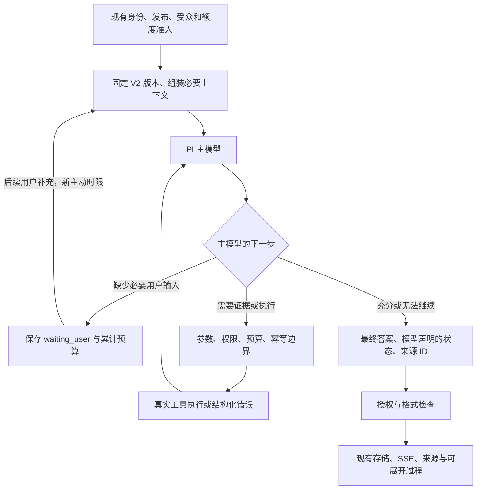

# Agent V2 独立开发线

日期：2026-10-19。状态：可独立运行的实验版本，生产默认仍为原 Pi runtime。历史失败、后续修复和仍未验收的边界见 [验收记录](agent-v2-validation.md)。不把机制测试通过等同于模型能自主正确处理所有请求。

分支：`codex/agent-architecture`；基线：`0387c5f`。隔离 worktree：`/Users/neo/.codex/worktrees/agent-v2/Delegate`。原目录未跟踪的 reports/docs 保留，未带入本次开发线。

## 已核实的 PI 实现

仓库锁定 `@earendil-works/pi-agent-core@0.85.1` 和 `@earendil-works/pi-ai@0.85.1`。实现核对了安装包 README、`dist/agent.d.ts`、`dist/types.d.ts` 和 `dist/agent-loop.js`，以及 [对应 tag 的官方文档](https://github.com/earendil-works/pi/blob/v0.85.1/packages/agent/README.md)。未升级框架。

实际使用 `Agent`、`streamFn`、`beforeToolCall`、`prepareNextTurnWithContext`、`shouldStopAfterTurn`、`subscribe`、`abort`。PI 自己维护模型/工具循环、参数处理、工具返回配对与事件。一个 batch 中出现 `executionMode: sequential` 工具时，0.85.1 会将整个 batch 串行执行；V2 对写操作使用这个原生行为，另用信号感知的 semaphore 限制独立读取并发。

## 主流程与责任



主模型决定 RAG 是否适用、澄清、工具/Skill/参数、组合与顺序、证据充分性、冲突和时效，以及失败后修正或停止。默认不确定覆盖时先一次 RAG；翻译/润色、完整材料总结、实时信息、明确来源约束和已有有效证据允许跳过。内部事实未找到不得用互联网或常识补造。

服务端维护注册、执行、参数和权限、预算、取消、并发、真实追踪及会话。语义判断留在正常的下一轮模型响应中。仅检查来源 ID 存在，不能由此断言内容支持结论。无效引用的整段答案被拦下；已有来源但缺少可解析引用时结果标记 partial，不启动额外核验模型。

`waiting_user` 来自主模型的 `<waiting_user>` 状态标记或 `request_clarification` 工具，服务端不靠天气/政策等词语推断。等待用户期间没有活动定时器。恢复重新计主动时限，保留原任务输入与累计轮次、尝试、token、费用及已尝试写入指纹。模型仍可能错误声明状态，此问题通过真实评估暴露，不能用格式检查证明语义正确。

## V2 放弃了哪些旧决策

- 不调用 `DelegatePiAgentRuntime.run`、旧 `buildPiTools`、`GoalExecutionState`、固定 final review/rewrite。
- 不调用 ordinary-question 知识预取、simple/selective-text 分流、知识问题正则、旧证据需求派生。
- 不调用知识查询重写、引用关键词过滤、附件专项 Skill 选择/恢复与输出文件名推断。
- 不根据任务关键词隐藏/替换工具；大量目录仅提供通用词项发现和分页。

唯一复用的旧 worker 导出是 `buildPiAdapters({ orchestration: "model_v2" })` 与渠道交付函数。该显式模式跳过上述适配器内的旧决策，并使用模型原始查询、授权正文和实际来源标识。它不是旧 runtime 的包裹层。旧默认模式保持原行为；用 import 边界测试防止 V2 core 引入旧决策模块。

## 复用与安全边界

- PI 模型客户端及现有 provider 配置；V2 factory 禁用 SDK 隐式重试。
- `recallRepresentativeContext` / OpenViking / Memory UseRun，限定 `PUBLIC_KNOWLEDGE`，保留当前授权与撤回检查。
- 已发布具体 MCP schema、服务端行为分类、Compute Broker 的准入/审批/幂等及执行回执。
- V2 附带 `rejectApprovalWait` 收紧约束。Broker 在执行时将所有最终 ask 决策改为 deny；客户端先查询受认证的 `/internal/compute/features`，旧 broker 不支持则不发送执行请求，避免未知字段被旧 schema 丢弃。
- 已安装版本固定的 Skills、受限 Python/浏览器/文件能力。
- 会话 principal、租户/受众/版本边界、工作租约、钱包准入、Postgres 消息保存和渠道交付。
- `PiTelemetry` 与现有审计最小化方法。真实调用记录只含调用标识哈希、注册名称、类别、参数数量、时间、状态、来源哈希、大小和尝试次数；不保留 raw arguments、完整工具返回、密钥或隐藏思维。

`AgentContextAuthorization` 在每次模型调用、工具派发、结果接收和最终释放处复查。拒绝会终止相应 run，不允许换工具绕过。未知行为工具拒绝派发。写操作串行，不做基础设施重试；结果未知停止且明确告知查回执。主机适配器仍须实施持久幂等与远程取消，单纯 AbortSignal 无法撤销已发生的外部效果。

已有代表的 `answerScope=owner_and_domain` 或 `knowledgePolicy=domain_only` 在旧 worker 中要求专项语义审核。当前 V2 在模型/工具开始前明确阻止这些代表试运行，不默默丢掉审核要求，也不退回旧审核链。默认未切换的代表照常使用旧版本。

## 入口与文件

| 文件/目录 | 用途 |
| --- | --- |
| `packages/model-runtime/src/v2/prompt.ts` | 实际接入的核心系统提示词 |
| `v2/runtime.ts` | 单一 PI 循环、事件、预算、来源、澄清状态 |
| `v2/config.ts` / `guards.ts` | 集中配置、时限、并发和输出边界 |
| `v2/capabilities.ts` | RAG、具体 MCP、Search、Skills、沙盒/浏览器定义 |
| `v2/provider.ts` | 复用 PI provider，关闭隐式模型重试 |
| `v2/cli.ts` / `fixtures.ts` | 独立本地入口、显式合成工具 |
| `v2/evaluate.ts` | 真模型决策 + 受控工具数据，对照旧版本 |
| `apps/conversation-worker/src/processor-v2.ts` | 现有聊天入口的显式 V2 分支 |
| `packages/compute-protocol` / `apps/compute-broker` / `compute-client.ts` | 无审批等待的单调收紧约束及协议能力检查 |
| `packages/web-data/src/agent-v2-session.ts` | 同 episode、同版本、同受众范围的澄清恢复 |
| `public-agent-presentation.ts` / `public-agent-feedback.tsx` | 授权后的来源和可展开真实过程 |

独立包入口为 `@delegate/model-runtime/v2`。core 不依赖数据库；必须由调用方提供可信 `authorize` 回调。不要将这个 in-process 接口直接作为匿名公网 API。

## 本地启动

在 worktree 根目录：

```sh
pnpm install --frozen-lockfile
pnpm db:generate
pnpm test:agent:v2
pnpm agent:v2 -- "翻译成英文：会议改到明天。"
```

沿用 `.env.example` 的 `DELEGATE_MODEL_PROVIDER` 和相应 provider 凭据。不会打印凭据；不将原工作区 `.env` 复制或提交。可以通过 `node --env-file=/absolute/path/to/.env --import tsx ...` 显式加载本地配置。

演示检索及恢复（真实模型、明确的合成工具，不能当现实业务/天气服务）：

```sh
pnpm agent:v2 --fixture-tools --session .local/agent-v2-session.json "查询星河科技的员工年假制度"
pnpm agent:v2 --fixture-tools --session .local/agent-v2-session.json "今天的天气如何"
pnpm agent:v2 --fixture-tools --session .local/agent-v2-session.json "上海"
```

CLI 默认没有业务工具；`--fixture-tools` 才启用合成库、合成天气和实际数值乘法。session 文件为本地开发者拥有的 0600 文件；不是客户端可提交的授权凭证。完成后状态写为 null。Ctrl-C 传递取消信号。

在已有**隔离测试数据库/服务栈**中接入现有 Web 聊天：

```sh
DELEGATE_AGENT_VERSION=v2 \
DELEGATE_AGENT_V2_REPRESENTATIVES=your-test-representative-slug \
pnpm dev:conversation-worker
```

上述两个变量必须同时设置且 slug 精确匹配。聊天仍访问 `/reps/<slug>/chat`、既有 run/SSE 接口，无需新建前端。首次认领在数据库租约内固定 `agentVariant`；已启动旧 Pi 工作/旧审批不会改跑 V2。移除开关会使新请求回到旧版本，已固定 V2 的在途请求继续按原版本收尾。测试期间不要混用配置不一致的 worker 消费同一测试队列。

使用 MCP/沙盒/浏览器时，隔离测试栈的 Compute Broker 也须使用本开发线代码；旧 broker 会因不支持 `rejectApprovalWait` 而被拒绝。这个协议限制只会把 ask 收紧为 deny，不能把 deny/ask 升为 allow。

Web 显示现有进度阶段、最终来源和可展开的调用状态/耗时。公网投影不含内部工具名、参数、回执正文和 ID；内部审计保存实际注册工具名称。样式沿用 `DESIGN.md` 颜色、字体和 4px 间距，原生 details 支持键盘。

## 配置与预算

均以 `DELEGATE_V2_` 为前缀，完整默认值见 `config.ts`。这些是初始防护值，**待真实负载调整，不是性能最优结论**。

| 后缀 | 默认值 | 说明 |
| --- | ---: | --- |
| `ACTIVE_MS` | 120000 | 单次 PI 主动执行时限；不包含等待用户的时间 |
| `FINAL_RESERVE_MS` | 15000 | 保留收尾窗口，禁止新工具耗尽它 |
| `TOOL_TIMEOUT_MS` | 25000 | 工具尝试的共享时限，受总时限进一步限制 |
| `MODEL_TURNS` | 8 | 一个任务累计模型轮次，最后一轮收尾 |
| `TOOL_CALLS` | 12 | PI 提出的工具调用数，含参数/权限阻止的提议 |
| `ATTEMPTS` | 16 | 模型请求 + 工具实际尝试/基础设施重试总数，预留一次最终模型请求 |
| `CONCURRENCY` | 3 | 独立只读调用并发上限；写调用使原生 batch 串行 |
| `TOOL_OUTPUT_BYTES` | 12000 | 完整 JSON 结果包大小，包括来源/产物元数据 |
| `CONTEXT_BYTES` | 64000 | 完整发送上下文大小；超限明确停止，不偷偷删掉当前任务或调用配对 |
| `TOTAL_TOKENS` | 200000 | 累计计量预算，发送前按 UTF-8 大小保守准入 |
| `OUTPUT_TOKENS` | 2048 | 每次最大输出 |
| `FINAL_RESERVE_TOKENS` | 512 | 最后回答保留输出量 |
| `READ_RETRIES` | 1 | 仅 host 明确分类为 transient 的只读错误 |
| `DIRECT_TOOLS` | 16 | 小目录直接暴露；大目录 discover_tools 分页加载 |
| `TEMPERATURE` | 0 | 初始低随机性配置，不保证模型策略正确 |
| `THINKING_TOKENS` | 1024 | 已验证 profile 的原生思考上限，包含在输出额度内；0 关闭，最后收尾或输出不足时关闭 |
| `REASONING_PROFILE` | auto | 自动应用已验证的 Qwen Plus 配置；可显式设为 `qwen-chat-template`，仅用于支持对应字段的 Chat Completions 端点 |
| `COST_USD` | 未设置 | 可选费用准入；必须有可信的模型输入/输出单价，否则拒绝 |
| `TIMEZONE` | Asia/Shanghai | worker/CLI 的可信时区；不能从访客文本授予身份或位置 |

token usage 使用 provider 的实际值；没有 usage 时以保守估值扣减预算。费用基于配置单价，`costAvailable=false` 时 0 不是“免费”，也不是实际账单。模型客户端超时仍受既有 `DELEGATE_MODEL_TIMEOUT_MS` 约束；模型容量使用既有 `DELEGATE_PI_CONTEXT_WINDOW_TOKENS` 配置，应依据真实 provider 容量设置。外部自定义 adapter 不得隐藏重试；必须把可重试错误抛成 `V2Error("transient")`，由 V2 统一计数。

V2 默认对已验证的 `agicto`/`bailian`、`openai-completions`、`qwen-plus` 组合使用 PI 原生 Qwen thinking profile；这是模型能力适配，不依赖用户问题或业务关键词。思考发生在正常主模型请求内，不引入核验链，正文不会写入追踪或澄清状态。其他模型默认保留原绑定，旧 Pi 入口不变。具体质量、耗时取舍和复测见[澄清修复验收](agent-v2-clarification-fix.md)。

自托管端点可显式配置 `DELEGATE_V2_REASONING_PROFILE=qwen-chat-template`。PI 0.85.1 会发送 `chat_template_kwargs.enable_thinking` 和 `thinking_token_budget`，而非 Qwen Plus 的顶层 `enable_thinking` / `thinking_budget`。必须先验证服务端支持；不能仅凭模型名字套用。当前本地 `qwen3.8-27b` 的配置、复测及限制见[模型切换验收](agent-v2-qwen38-validation.md)。

SDK 的 `authorizedUserLocation` 只能由可信主机提供已获授权的位置，缺省为 `null`；worker 不从时区、IP 或检索结果推断位置。模型同时收到本次真实工具结果摘要（不含原始参数），避免把工具描述或计划当成已经执行。

## 来源、状态与数据保存

返回 `text / sources / artifacts / status / calls / events / spans / usage / taskUsage / firstTextMs`。来源 ID 由范围、来源身份、版本和 URL 稳定派生；模型使用 `[S:id]`，worker 映射为允许公开的来源标题，真实链接通过既有来源栏显示。内部 ledger 映射 `sourceBindings` 不进入公开 API 或审计。

流式过程事件来自真实 PI/工具事件。最终文字在本轮结束、来源格式检查及授权释放后发送；当前不展示模型的工具前猜测、未结束草稿或隐藏思维。因此 `firstTextMs` 是首个释放的最终文字时刻，不等于 provider 首 token。这里选择安全缓冲，不声称已实现逐 token 的可验证事实流。

worker 将最小 `v2Task` 存入原有 `GenerationRun.contextSnapshot.agentTrace`，与最终消息事务一起保存，无需迁移表结构。澄清恢复只重新读取同 episode 的未删除用户消息、同代表版本和范围；关闭短期记忆时不恢复。检索正文、Skill 正文、工具结果不写入该状态。跨请求证据未获得当前 UseRun 重新授权时，不复用旧正文，必要时重新检索。

## 已知限制与切换前条件

1. 初轮两项行为失败已完成[定向修复与多轮真实复测](agent-v2-clarification-fix.md)；历史失败保留。有限样本不代表开放任务均可靠，也不能以 mocked tests 证明自主行为。
2. 新的审批等待/恢复尚未实现 V2 checkpoint 协议。试运行明确阻止需要新审批、未知行为和不满足 allow 模式的沙盒/浏览器操作；不会自动回退旧流程或静默创建审批。一般写入的持久幂等仍由 Compute Broker 执行。
3. 保留明确的专项语义审核边界：上述受限代表配置暂不能进入 V2。并未用一个全局审核模型代替它。
4. 主机目前没有单独配置 `web` Search adapter，实际生产能力依赖发布的具体 MCP 搜索工具或允许的沙盒浏览器。独立库的 Search adapter 接口已实现，演示使用合成工具。
5. 当前生产沙盒仍遵循原有 Python、附件归属、单文本产物等底层限制；V2 不将它包装成无限制 shell 或任意文件编辑器。RAG 主机没有返回文档更新时间/公开版本的字段时保持缺失，不伪造时效。
6. 已部署独立本地 Postgres + OpenViking + Compute Broker 验收栈，入口、自检和 10 个手工用例见[本地部署记录](agent-v2-local-deployment.md)。这不覆盖全部权限/账单/渠道组合，也不代表在线检索质量或负载压测完成。已有渠道交付使用原实现；无法强制撤销远程已提交的效果。
7. 初始版本只做有界上下文和按需工具发现，没有复杂缓存或新增规划服务。超大任务可明确因 context/budget limit 停止。

未来切换生产入口前：补齐当前授权/撤回、账单、来源投影、断线恢复和失败交付验收；补齐所需审批协议与专项审核扩展；对目标模型/任务集评估重复样本并人工检查关键结论支持；之后再逐代表扩大显式白名单。生产默认配置仍未改变，没有删除旧代码或业务数据。
